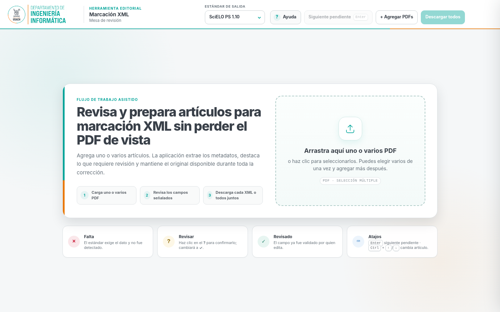
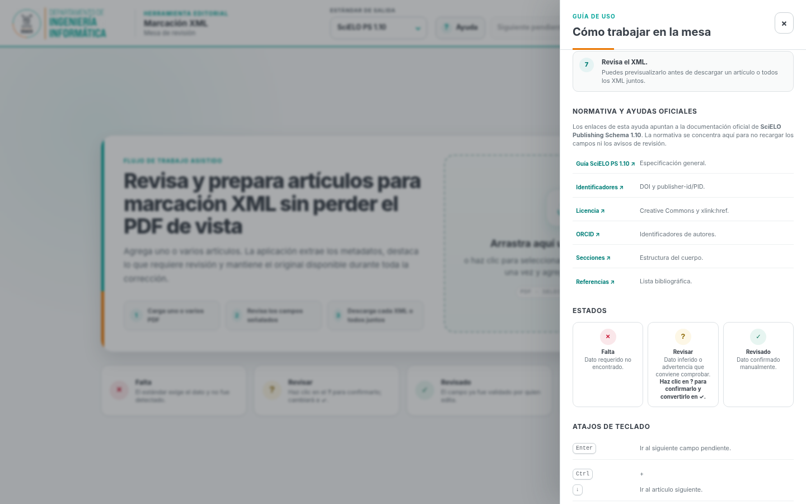
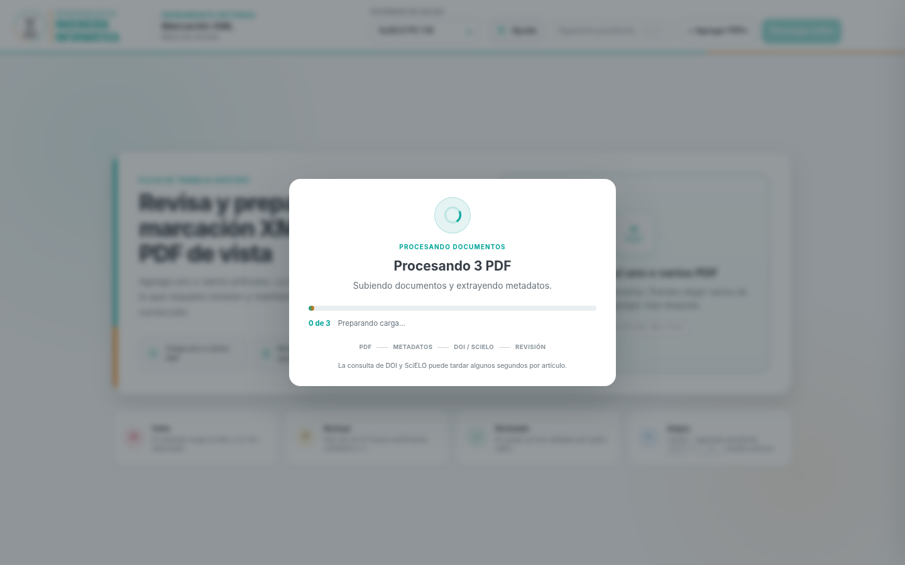

# PDF2JATS · Mesa de Marcación XML

[Español](#español) · [English](#english)

## Español

Herramienta web para **revisar, corregir y preparar artículos científicos en XML** a partir de archivos PDF, manteniendo el documento original visible durante todo el proceso editorial.

**Autor:** Manuel José Villalobos Cid  
**Institución:** Departamento de Ingeniería Informática (DIINF), Universidad de Santiago de Chile

> Proyecto desarrollado para apoyar flujos editoriales de preparación y revisión de metadatos, contenido, referencias y salida XML compatible con perfiles basados en JATS y SciELO Publishing Schema.



### Funcionalidades principales

- Carga **uno o varios PDF** y permite agregar nuevos documentos posteriormente.
- Muestra una ventana de espera con progreso mientras se procesa cada archivo.
- Mantiene el **PDF original junto a la ficha editable**.
- Organiza la revisión en pestañas: **Metadatos, Autoría, Contenido, Referencias y Salida XML**.
- Detecta DOI y combina metadatos bibliográficos desde fuentes abiertas.
- Consulta SciELO cuando el artículo ya está indexado y recupera el PID cuando está disponible.
- Permite editar títulos, resúmenes, palabras clave, autores, filiaciones, secciones y referencias.
- Permite corregir secciones detectadas erróneamente sin perder el contenido.
- Busca DOI de referencias y aplica metadatos estructurados cuando la coincidencia es suficientemente confiable.
- Genera salida XML por artículo o descarga conjunta, en tres perfiles (ver [Perfiles de salida](#perfiles-de-salida)).
- Incluye ayudas contextuales y una sección centralizada de **normativa oficial**.

### Cómo se revisan los campos

La aplicación usa tres estados visuales:

- **× Falta:** el dato requerido no fue encontrado.
- **? Revisar:** el dato fue inferido o requiere confirmación.
- **✓ Revisado:** el dato fue confirmado.

Cuando aparece un **?**, haz clic sobre él para confirmar el bloque; el símbolo cambia a **✓**. Si editas un campo, también queda marcado como revisado automáticamente. Qué campos se exigen depende del perfil de salida elegido en el selector **Estándar de salida**.



### Carga múltiple

Los PDF pueden seleccionarse de forma múltiple. Durante la carga se muestra el documento actual, el contador de avance y el estado del procesamiento. La interfaz envía los archivos uno por uno, de modo que un PDF con problemas no detiene a los demás.



### Normativa y fuentes externas

La interfaz concentra los enlaces normativos dentro del panel **Ayuda**, evitando repetir enlaces en cada observación o campo.

El proyecto trabaja con referencias a:

- **SciELO Publishing Schema 1.10**.
- **NISO JATS 1.3**.
- DOI Content Negotiation.
- Crossref REST API.
- DataCite API.
- Búsqueda pública de SciELO para artículos ya incorporados.

Consulta [docs/NORMATIVA.md](docs/NORMATIVA.md) para los enlaces oficiales utilizados por la aplicación.

### Perfiles de salida

Los tres perfiles salen del mismo modelo interno del artículo. La interfaz parte con SciELO PS y el selector **Estándar de salida** permite cambiarlo.

| Perfil en la API | Qué genera | Codificación | Archivo descargado |
|---|---|---|---|
| `sps` | SciELO Publishing Schema 1.10: JATS Publishing 1.1 con `specific-use="sps-1.10"` | UTF-8 | `<nombre>.sps.xml` |
| `jats` | NISO JATS 1.3 Journal Publishing | UTF-8 | `<nombre>.jats.xml` |
| `wos` | Formato heredado Clarivate / SciELO Citation Index: solo metadatos, sin cuerpo, con citas `nlm-citation` | ISO-8859-1 | `<nombre>.wos.xml` |

`<nombre>` es el nombre del PDF sin extensión, con los espacios cambiados por `_`. La descarga conjunta entrega `xml_<perfil>.zip`. En el perfil `wos`, los caracteres que no existen en ISO-8859-1 se escriben como referencias de carácter XML.

### Estructura del repositorio

```text
PDF2JATS/
├── app.py
├── requirements.txt
├── ACTIVAR.sh
├── core/
│   ├── __init__.py
│   ├── pdf_reader.py
│   ├── layout.py
│   ├── front_matter.py
│   ├── autoria.py
│   ├── cuerpo_refs.py
│   ├── doi_metadata.py
│   ├── reference_metadata.py
│   ├── scielo_metadata.py
│   ├── model.py
│   ├── revision.py
│   └── extractor.py
├── emisores/
│   ├── __init__.py
│   ├── base.py
│   ├── jats.py
│   └── scielo.py
├── web/
│   └── index.html
├── docs/
│   ├── ARQUITECTURA.md
│   ├── GUIA_USO.md
│   ├── INSTALACION.md
│   ├── NORMATIVA.md
│   └── images/
├── AUTHORS.md
├── CHANGELOG.md
├── CITATION.cff
├── CONTRIBUTING.md
└── SECURITY.md
```

| Carpeta o archivo | Contenido |
|---|---|
| `app.py` | Servidor Flask: entrega la interfaz, guarda la sesión de trabajo y expone la API. |
| [core/](core/) | Módulos que leen el PDF, extraen el artículo, lo enriquecen con DOI y SciELO y calculan los estados de revisión. |
| [emisores/](emisores/) | Módulos que transforman el modelo del artículo en XML JATS, SciELO PS y Clarivate. |
| [web/](web/) | Interfaz completa en un solo `index.html`. |
| [docs/](docs/) | Guía de uso, arquitectura, instalación, normativa y capturas de pantalla. |
| `ACTIVAR.sh` | Script de despliegue para el servidor institucional. |

Cada carpeta tiene su propio README con el detalle de sus archivos.

### Ejecución local

Para probar la aplicación en un computador basta con instalar las dependencias y correr el servidor de desarrollo de Flask desde la carpeta del proyecto:

```bash
cd PDF2JATS
python3 -m venv .venv
.venv/bin/python -m pip install -r requirements.txt
.venv/bin/python app.py
```

Después abre `http://127.0.0.1:5000` en el navegador. `app.py` escucha en el puerto 5000 con el modo de depuración apagado. El archivo `web/index.html` no funciona abierto con doble clic, porque toda la interfaz trabaja contra la API en `/api/...` y necesita que `app.py` la sirva. La interfaz calcula la dirección de la API a partir de la URL de la página, así que funciona tanto en `/` como publicada bajo un prefijo, por ejemplo `/PDF2JATS/`.

Las versiones mínimas que pide `requirements.txt` (Flask 3.0 y PyMuPDF 1.24) necesitan Python 3.8 o superior. Las consultas de metadatos requieren salida a internet; si no la hay, la extracción sigue con lo que se obtiene del PDF.

### Instalación rápida

Requiere Python 3 y un entorno virtual. En el servidor institucional utilizado para producción:

```bash
cd /var/www/html/PDF2JATS
bash ACTIVAR.sh
```

El script crea `.venv` si no existe, instala las dependencias, valida los módulos Python, reinicia `pdf2jats.service` y comprueba que Gunicorn responda localmente. Solo funciona en ese servidor, porque entra a la ruta fija `/var/www/html/PDF2JATS` y reinicia un servicio que ya debe estar configurado.

Para una instalación nueva o una configuración con Apache/Gunicorn, consulta [docs/INSTALACION.md](docs/INSTALACION.md).

### Dependencias

Las dependencias Python declaradas son:

```text
Flask >= 3.0
PyMuPDF >= 1.24
lxml >= 5.0
gunicorn >= 22.0
```

Gunicorn solo hace falta en producción. La interfaz no carga librerías externas: el CSS, el JavaScript y el logo van dentro de `web/index.html`.

### Variables de entorno

| Variable | Efecto | Valor por defecto |
|---|---|---|
| `PDF2JATS_DOI_LOOKUP` | Con `0`, `false`, `no` u `off` apaga la consulta de metadatos por DOI (DOI.org, Crossref, DataCite y la página a la que resuelve el DOI). La búsqueda en SciELO y la búsqueda de DOI de referencias siguen activas. | `1` |
| `PDF2JATS_DOI_TIMEOUT` | Tiempo máximo de espera de cada consulta, en segundos. | 4,5 en la consulta del DOI del artículo y 5,5 en la búsqueda de DOI de referencias |
| `PDF2JATS_USER_AGENT` | Cabecera `User-Agent` de la consulta por DOI y de la búsqueda de referencias en Crossref. La consulta a SciELO usa una cabecera fija. | `PDF2JATS/1.4 (doi2bib-compatible DOI metadata lookup)` y `PDF2JATS/1.3 (reference DOI lookup)` |
| `PDF2JATS_CROSSREF_MAILTO` | Correo que la búsqueda de referencias envía a Crossref en el parámetro `mailto`. Con él, la espera mínima entre consultas baja de 1,05 s a 0,36 s. | vacío |

### Rutas de la API

La interfaz usa estas rutas. `<sid>` es el identificador de 12 caracteres que el servidor asigna a cada PDF cargado y `<perfil>` es `sps`, `jats` o `wos`. Las rutas que devuelven la ficha de estados aceptan el perfil con que se evalúan los campos (`sps` si no se indica).

| Método | Ruta | Qué hace |
|---|---|---|
| GET | `/` | Entrega `web/index.html`. |
| POST | `/api/extraer` | Recibe uno o más PDF en el campo `pdfs`, guarda cada uno con su `sid`, extrae el artículo y devuelve la ficha, los datos y las alertas. |
| POST | `/api/doi/<sid>` | Vuelve a consultar el DOI (el que llega en el cuerpo JSON o el guardado) en las fuentes por DOI y en SciELO, y completa la ficha. |
| POST | `/api/scielo/<sid>` | Busca el artículo en SciELO por DOI y recupera su PID; si no está publicado ahí, el PID queda vacío. |
| POST | `/api/referencia/buscar/<sid>/<i>` | Busca hasta tres candidatos DOI en Crossref para la referencia `i` sin modificarla. |
| POST | `/api/referencia/aplicar/<sid>/<i>` | Aplica a la referencia `i` el candidato que eligió el editor. |
| POST | `/api/referencias/buscar/<sid>` | Busca DOI para las referencias que no lo tienen (60 por defecto, 80 como máximo) y aplica solo los candidatos con confianza igual o mayor que el umbral (0,86 por defecto); los dudosos vuelven aparte. |
| GET | `/api/pdf/<sid>` | Devuelve el PDF original. |
| GET | `/api/pagina/<sid>/<n>` | Devuelve la página `n` (desde 0) como PNG; el parámetro `escala` va de 1,0 a 3,0 y vale 1,6 por defecto. |
| GET | `/api/paginas/<sid>` | Devuelve el número de páginas del PDF. |
| GET | `/api/articulo/<sid>` | Devuelve la ficha, los datos y las alertas del artículo. |
| POST | `/api/guardar/<sid>` | Guarda en la sesión los campos editados. |
| POST | `/api/revisar/<sid>/<campo>` | Marca un campo como revisado por el editor. |
| POST | `/api/propagar/<sid>` | Copia los datos de revista (título, abreviatura, ISSN, editorial, volumen, número y año) de un artículo al resto del lote. |
| GET | `/api/xml/<sid>/<perfil>` | Devuelve el XML del perfil dentro de un JSON, para la vista previa. |
| GET | `/api/descargar/<sid>/<perfil>` | Descarga el XML del artículo. |
| GET | `/api/lote/<perfil>` | Descarga un ZIP con el XML de todos los artículos cargados. |
| GET | `/api/cola` | Lista las fichas de estado en el orden de carga. |
| POST | `/api/quitar/<sid>` | Quita un artículo de la sesión y borra su PDF. La interfaz no tiene un botón para esta acción. |
| POST | `/api/limpiar` | Vacía la sesión y la carpeta temporal de PDF. La interfaz no tiene un botón para esta acción. |

### Límites de operación

- La sesión de trabajo vive en la memoria del proceso de Python. Se pierde al reiniciar el servicio y no se comparte entre procesos, por lo que conviene correr Gunicorn con un solo worker mientras la sesión no se guarde en otro lugar: con varios workers, una petición puede llegar a un proceso que no conoce el artículo y responder "no encontrado".
- La sesión es una sola para todo el servicio: quien abre la aplicación ve la cola de artículos que cargaron los demás.
- Los PDF se guardan en la carpeta `pdf2jats_pdfs` dentro de la carpeta temporal del sistema (en Linux, normalmente `/tmp/pdf2jats_pdfs`) y quedan ahí hasta que se quita el artículo, se limpia la sesión o el sistema vacía su carpeta temporal.
- Flask rechaza peticiones de más de 120 MB. Como la interfaz envía un PDF por petición, ese es el tamaño máximo de cada archivo.

### Flujo general

```text
PDF
 ↓
Extracción de texto y estructura
 ↓
Detección / enriquecimiento de metadatos
 ↓
Revisión editorial en la interfaz
 ↓
Corrección de contenido y referencias
 ↓
Validación de pendientes
 ↓
XML JATS / SciELO PS / Clarivate
```

Más detalle en [docs/ARQUITECTURA.md](docs/ARQUITECTURA.md) y en la [guía de uso](docs/GUIA_USO.md).

### Autoría y citación

**Manuel José Villalobos Cid** y el **Departamento de Ingeniería Informática (DIINF), Universidad de Santiago de Chile** se presentan como autores institucionales del proyecto ([AUTHORS.md](AUTHORS.md)). Para citar el software, el repositorio incluye `CITATION.cff`. El proyecto no incluye un archivo de licencia.

### Estado del proyecto

Versión documentada: **1.10** · agosto de 2026 ([CHANGELOG.md](CHANGELOG.md)).

La herramienta asiste la preparación editorial, pero la revisión final del XML y su cumplimiento con las reglas de la colección o plataforma de destino siguen requiriendo validación editorial.

## English

Web tool to **review, correct and prepare scientific articles in XML** from PDF files, keeping the original document visible throughout the editorial process.

**Author:** Manuel José Villalobos Cid  
**Institution:** Departamento de Ingeniería Informática (DIINF), Universidad de Santiago de Chile

> Project developed to support editorial workflows that prepare and review metadata, content, references and XML output compatible with profiles based on JATS and the SciELO Publishing Schema.


### Main features

- Loads **one or several PDFs** and lets you add more documents later.
- Shows a progress window while each file is processed.
- Keeps the **original PDF next to the editable record**.
- Organises the review in tabs: **Metadata, Authorship, Content, References and XML output** (the interface labels are in Spanish: Metadatos, Autoría, Contenido, Referencias and Salida XML).
- Detects the DOI and merges bibliographic metadata from open sources.
- Queries SciELO when the article is already indexed and retrieves its PID when available.
- Lets you edit titles, abstracts, keywords, authors, affiliations, sections and references.
- Lets you fix wrongly detected sections without losing their content.
- Looks up reference DOIs and applies structured metadata when the match is reliable enough.
- Produces XML per article or as a combined download, in three profiles (see [Output profiles](#output-profiles)).
- Includes contextual help and a single section with the **official standards**.

### How fields are reviewed

The application uses three visual states:

- **× Missing:** the required value was not found.
- **? Review:** the value was inferred or needs confirmation.
- **✓ Reviewed:** the value was confirmed.

When a **?** appears, click it to confirm the block; the symbol changes to **✓**. Editing a field also marks it as reviewed. Which fields are required depends on the output profile chosen in the **Estándar de salida** (output standard) selector.


### Multiple upload

Several PDFs can be selected at once. During the upload the interface shows the current document, a progress counter and the processing state. The interface sends the files one at a time, so a problematic PDF does not stop the others.


### Standards and external sources

The interface keeps the links to the standards inside the **Ayuda** (help) panel, so they are not repeated in every warning or field.

The project works with references to:

- **SciELO Publishing Schema 1.10**.
- **NISO JATS 1.3**.
- DOI Content Negotiation.
- Crossref REST API.
- DataCite API.
- SciELO public search, for articles already in the collection.

See [docs/NORMATIVA.md](docs/NORMATIVA.md) for the official links used by the application.

### Output profiles

The three profiles come from the same internal article model. The interface starts with SciELO PS, and the **Estándar de salida** selector switches between them.

| Profile in the API | What it produces | Encoding | Downloaded file |
|---|---|---|---|
| `sps` | SciELO Publishing Schema 1.10: JATS Publishing 1.1 with `specific-use="sps-1.10"` | UTF-8 | `<name>.sps.xml` |
| `jats` | NISO JATS 1.3 Journal Publishing | UTF-8 | `<name>.jats.xml` |
| `wos` | Legacy Clarivate / SciELO Citation Index format: metadata only, no body, with `nlm-citation` references | ISO-8859-1 | `<name>.wos.xml` |

`<name>` is the PDF file name without its extension, with spaces replaced by `_`. The combined download returns `xml_<profile>.zip`. In the `wos` profile, characters that do not exist in ISO-8859-1 are written as XML character references.

### Repository layout

```text
PDF2JATS/
├── app.py
├── requirements.txt
├── ACTIVAR.sh
├── core/
│   ├── __init__.py
│   ├── pdf_reader.py
│   ├── layout.py
│   ├── front_matter.py
│   ├── autoria.py
│   ├── cuerpo_refs.py
│   ├── doi_metadata.py
│   ├── reference_metadata.py
│   ├── scielo_metadata.py
│   ├── model.py
│   ├── revision.py
│   └── extractor.py
├── emisores/
│   ├── __init__.py
│   ├── base.py
│   ├── jats.py
│   └── scielo.py
├── web/
│   └── index.html
├── docs/
│   ├── ARQUITECTURA.md
│   ├── GUIA_USO.md
│   ├── INSTALACION.md
│   ├── NORMATIVA.md
│   └── images/
├── AUTHORS.md
├── CHANGELOG.md
├── CITATION.cff
├── CONTRIBUTING.md
└── SECURITY.md
```

| Folder or file | Content |
|---|---|
| `app.py` | Flask server: serves the interface, keeps the working session and exposes the API. |
| [core/](core/) | Modules that read the PDF, extract the article, enrich it from the DOI and SciELO and compute the review states. |
| [emisores/](emisores/) | Modules that turn the article model into JATS, SciELO PS and Clarivate XML. |
| [web/](web/) | The whole interface in a single `index.html`. |
| [docs/](docs/) | User guide, architecture, installation, standards and screenshots. |
| `ACTIVAR.sh` | Deployment script for the institutional server. |

Each folder has its own README with the details of its files.

### Running locally

To try the application on a computer, install the dependencies and start the Flask development server from the project folder:

```bash
cd PDF2JATS
python3 -m venv .venv
.venv/bin/python -m pip install -r requirements.txt
.venv/bin/python app.py
```

Then open `http://127.0.0.1:5000` in the browser. `app.py` listens on port 5000 with debug mode off. Opening `web/index.html` with a double click does not work, because the whole interface talks to the API under `/api/...` and needs `app.py` to serve it. The interface derives the API address from the page URL, so it works both at `/` and under a prefix such as `/PDF2JATS/`.

The minimum versions in `requirements.txt` (Flask 3.0 and PyMuPDF 1.24) need Python 3.8 or later. Metadata lookups need internet access; without it, extraction continues with what the PDF provides.

### Quick installation

It needs Python 3 and a virtual environment. On the institutional server used in production:

```bash
cd /var/www/html/PDF2JATS
bash ACTIVAR.sh
```

The script creates `.venv` if it does not exist, installs the dependencies, validates the Python modules, restarts `pdf2jats.service` and checks that Gunicorn answers locally. It only works on that server, because it moves to the fixed path `/var/www/html/PDF2JATS` and restarts a service that must already be configured.

For a new installation or an Apache/Gunicorn setup, see [docs/INSTALACION.md](docs/INSTALACION.md).

### Dependencies

The declared Python dependencies are:

```text
Flask >= 3.0
PyMuPDF >= 1.24
lxml >= 5.0
gunicorn >= 22.0
```

Gunicorn is only needed in production. The interface loads no external libraries: its CSS, JavaScript and logo are inside `web/index.html`.

### Environment variables

| Variable | Effect | Default |
|---|---|---|
| `PDF2JATS_DOI_LOOKUP` | With `0`, `false`, `no` or `off` it turns off the DOI metadata lookup (DOI.org, Crossref, DataCite and the page the DOI resolves to). The SciELO lookup and the reference DOI search stay active. | `1` |
| `PDF2JATS_DOI_TIMEOUT` | Maximum wait for each query, in seconds. | 4.5 for the article DOI lookup and 5.5 for the reference DOI search |
| `PDF2JATS_USER_AGENT` | `User-Agent` header of the DOI lookup and of the Crossref reference search. The SciELO lookup uses a fixed header. | `PDF2JATS/1.4 (doi2bib-compatible DOI metadata lookup)` and `PDF2JATS/1.3 (reference DOI lookup)` |
| `PDF2JATS_CROSSREF_MAILTO` | E-mail address that the reference search sends to Crossref in the `mailto` parameter. With it, the minimum wait between queries drops from 1.05 s to 0.36 s. | empty |

### API routes

The interface uses these routes. `<sid>` is the 12-character identifier that the server assigns to each uploaded PDF, and `<profile>` is `sps`, `jats` or `wos`. Routes that return the review record accept the profile used to evaluate the fields (`sps` when none is given).

| Method | Route | What it does |
|---|---|---|
| GET | `/` | Serves `web/index.html`. |
| POST | `/api/extraer` | Receives one or more PDFs in the `pdfs` field, stores each with its `sid`, extracts the article and returns the review record, the data and the warnings. |
| POST | `/api/doi/<sid>` | Queries the DOI again (the one in the JSON body or the stored one) in the DOI sources and in SciELO, and completes the record. |
| POST | `/api/scielo/<sid>` | Looks the article up in SciELO by DOI and retrieves its PID; when the article is not published there, the PID stays empty. |
| POST | `/api/referencia/buscar/<sid>/<i>` | Searches Crossref for up to three DOI candidates for reference `i` without changing it. |
| POST | `/api/referencia/aplicar/<sid>/<i>` | Applies the candidate chosen by the editor to reference `i`. |
| POST | `/api/referencias/buscar/<sid>` | Searches DOIs for the references that lack one (60 by default, 80 at most) and applies only the candidates whose confidence reaches the threshold (0.86 by default); doubtful ones are returned separately. |
| GET | `/api/pdf/<sid>` | Returns the original PDF. |
| GET | `/api/pagina/<sid>/<n>` | Returns page `n` (counting from 0) as PNG; the `escala` parameter goes from 1.0 to 3.0 and defaults to 1.6. |
| GET | `/api/paginas/<sid>` | Returns the number of pages of the PDF. |
| GET | `/api/articulo/<sid>` | Returns the review record, the data and the warnings of the article. |
| POST | `/api/guardar/<sid>` | Stores the edited fields in the session. |
| POST | `/api/revisar/<sid>/<campo>` | Marks a field as reviewed by the editor. |
| POST | `/api/propagar/<sid>` | Copies the journal data (title, abbreviation, ISSN, publisher, volume, issue and year) from one article to the rest of the batch. |
| GET | `/api/xml/<sid>/<profile>` | Returns the XML of the profile inside a JSON object, for the preview. |
| GET | `/api/descargar/<sid>/<profile>` | Downloads the XML of the article. |
| GET | `/api/lote/<profile>` | Downloads a ZIP with the XML of every uploaded article. |
| GET | `/api/cola` | Lists the review records in upload order. |
| POST | `/api/quitar/<sid>` | Removes an article from the session and deletes its PDF. The interface has no button for this action. |
| POST | `/api/limpiar` | Empties the session and the temporary PDF folder. The interface has no button for this action. |

### Operating limits

- The working session lives in the memory of the Python process. It is lost when the service restarts and is not shared between processes, so Gunicorn should run with a single worker until the session is stored elsewhere: with several workers, a request can reach a process that does not know the article and answer "no encontrado" (not found).
- There is one session for the whole service: anyone who opens the application sees the queue of articles uploaded by others.
- PDFs are stored in the `pdf2jats_pdfs` folder inside the system temporary folder (on Linux, usually `/tmp/pdf2jats_pdfs`) and stay there until the article is removed, the session is cleared or the system empties its temporary folder.
- Flask rejects requests larger than 120 MB. Since the interface sends one PDF per request, that is the maximum size of each file.

### General flow

```text
PDF
 ↓
Text and structure extraction
 ↓
Metadata detection / enrichment
 ↓
Editorial review in the interface
 ↓
Content and reference correction
 ↓
Check of pending fields
 ↓
XML JATS / SciELO PS / Clarivate
```

More detail in [docs/ARQUITECTURA.md](docs/ARQUITECTURA.md) and in the [user guide](docs/GUIA_USO.md).

### Authorship and citation

**Manuel José Villalobos Cid** and the **Departamento de Ingeniería Informática (DIINF), Universidad de Santiago de Chile** are presented as the institutional authors of the project ([AUTHORS.md](AUTHORS.md)). To cite the software, the repository includes `CITATION.cff`. The project does not include a licence file.

### Project status

Documented version: **1.10** · August 2026 ([CHANGELOG.md](CHANGELOG.md)).

The tool assists editorial preparation, but the final review of the XML and its compliance with the rules of the target collection or platform still require editorial validation.
