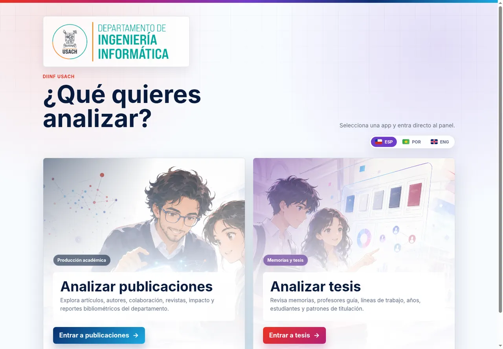
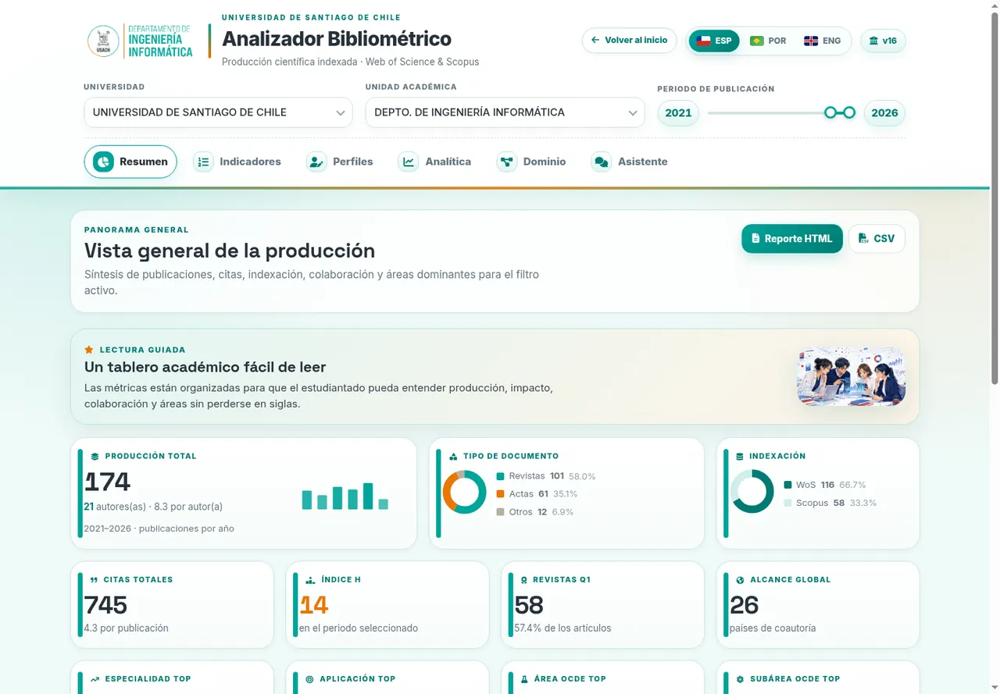
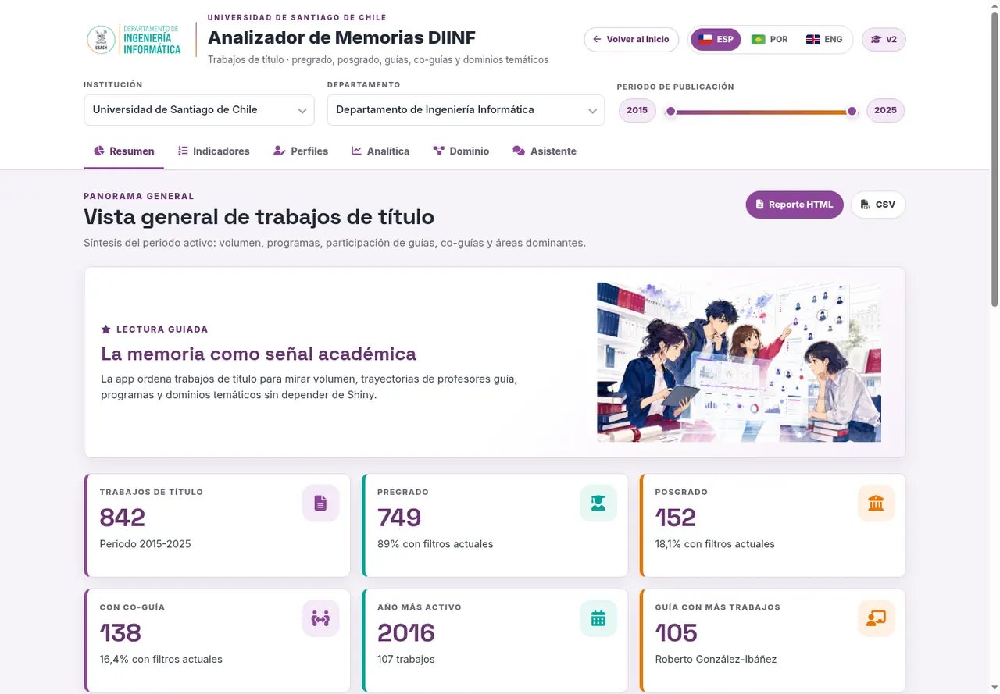

# ResearchAnalyser · DIINF USACH

[Español](#español) · [English](#english)

## Español

ResearchAnalyser es una app web estática para explorar la producción científica y los trabajos de título del Departamento de Ingeniería Informática (DIINF) de la Universidad de Santiago de Chile. Se abre con doble clic en `index.html`, sin servidor ni instalación, y funciona sin internet salvo en las partes que se indican en [Qué necesita red](#qué-necesita-red). La interfaz está en español, portugués e inglés, con el selector arriba a la derecha.

### Capturas

Las capturas de [docs/screenshots/](docs/screenshots/) muestran una versión anterior de la interfaz. El diseño actual cambió, pero sirven para ver la portada y el resumen de cada módulo.

| Portada | Publicaciones | Tesis y memorias |
|---|---|---|
|  |  |  |

### Abrir la aplicación

- `index.html` es la portada: desde ahí se elige Publicaciones o Tesis y memorias, y el enlace "Inicio" de la barra lateral de cada módulo vuelve a ella. La portada muestra cuántos registros tiene cada base; parte con las cifras escritas en el HTML y las reemplaza por el conteo real cuando termina de cargar el `data.js` de cada módulo.
- `publicaciones/index.html` y `tesis/index.html` son los dos módulos, y la cabecera permite pasar de uno a otro.
- Al abrir, cada módulo filtra los últimos cinco años hasta el año en curso, acotados a los años que tiene su base. El botón "Cambiar filtros" amplía o cambia ese periodo y las unidades consultadas.
- El navegador guarda el idioma elegido en `localStorage`: la portada y Tesis usan la clave `memorias_lang`, y Publicaciones usa `biblio_lang`.

### Los dos módulos

**Publicaciones** lee `publicaciones/data/data.js`, que empaqueta `publicaciones/data/BD_papers.csv`. La base tiene 1.285 registros y 45 campos; cada registro une una publicación con un académico de la unidad, de modo que una publicación firmada por varios académicos aparece varias veces. Esos registros corresponden a 1.034 títulos distintos y 41 académicos, de dos unidades: el Departamento de Ingeniería Informática (1.160 registros) e Ingeniería Civil Biomédica (125). Los años van de 1976 a 2027; lo fechado después del año en curso queda fuera del periodo por defecto hasta que se amplía el filtro. El pie de la página dice que los datos están actualizados al 12 de octubre de 2026.

**Tesis y memorias** lee `tesis/data/data.js`, que empaqueta `tesis/data/memorias.csv` y `tesis/data/academicos.csv`. La primera tiene 898 trabajos de título con 20 campos (años 2015 a 2025, con 56 trabajos sin año registrado y 790 con enlace al repositorio), y la segunda trae el correo y la URL de la foto de 59 académicos. El pie indica que la base está actualizada hasta el 1 de julio de 2026.

En los dos módulos la barra lateral lleva al Resumen, al catálogo (Publicaciones o Tesis y memorias, con la ficha completa de cada registro), a Académicos y unidad (perfiles), a Comparar académicos, a Áreas y evolución, a Análisis (indicadores, hallazgos, comparaciones y oportunidades) y a Informes, que genera reportes HTML y tablas CSV con los filtros activos. La cabecera abre el Asistente, y al pie de la barra están "Todas las herramientas" y "Base completa".

### Asistente

Responde en el navegador, sin API ni servidor, sobre las filas del filtro activo. Entiende la pregunta como una intención (contar, listar, ranking, comparar, coautores, temas, evolución por año, revistas, países, cuartiles, métricas, definir un área) más condiciones que se combinan en una misma frase: persona, años ("desde 2020", "entre 2018 y 2022", "últimos 5 años"), cuartil, WoS o Scopus, tipo de documento, tema, país, programa, rol de guía o co-guía y con o sin enlace. Cada respuesta parte con "Entendí: …" para que se pueda verificar qué condiciones aplicó. Funciona en español, inglés y portugués.

Las reglas comunes están en `shared/asistente.js`; los campos de cada base, los sinónimos propios y el formato de cada respuesta están en `publicaciones/app_chat.js` y `tesis/app_chat.js`. Para agregar equivalencias de términos (por ejemplo, un nuevo tema en dos idiomas) basta con añadirlas al mapa `SINONIMOS` del motor o al `CHAT_BILINGUAL_TERMS` del módulo. El asistente no usa Ollama ni ningún modelo externo.

### Estructura

| Ruta | Contenido |
|---|---|
| `index.html` | Portada con las tarjetas de los dos módulos. |
| [publicaciones/](publicaciones/) | Módulo de publicaciones: página, scripts, estilos, datos, librerías y tipografías. |
| [tesis/](tesis/) | Módulo de tesis y memorias. Usa las librerías de `publicaciones/lib/` y tiene sus propios datos, estilos y tipografías. |
| [shared/](shared/) | Estilos y scripts comunes a la portada y a los dos módulos (tema visual, colores institucionales, controles de comparación y motor del asistente). También guarda copias de librerías, fuentes e imágenes que ninguna página carga. |
| [herramientas/](herramientas/) | Herramientas para armar y corregir las bases: `procesador.html`, `gestor_tesis.html` y `configurar_ollama.bat`. |
| [warmup/](warmup/) | Script y unidad systemd que dejan un modelo cargado en Ollama. |
| [docs/](docs/) | Capturas de pantalla de una versión anterior. |
| `CITATION.cff`, `LICENSE` | Cita del software y licencia. |
| `.nojekyll` | Marca vacía para GitHub Pages; hay otra en `publicaciones/` y otra en `tesis/`. |

### Actualizar los datos

Los módulos leen `data/data.js`, no los CSV, así que después de editar un CSV hay que regenerar el `data.js` correspondiente. La cifra de la portada se actualiza sola al cargar el nuevo archivo.

Publicaciones: edita `publicaciones/data/BD_papers.csv` (separador `|`) y ejecuta `python regenerar_datos.py` dentro de `publicaciones/`, o `Rscript Conversor_Papers_BD_JS_v2.R` dentro de `publicaciones/data/`. Los dos escriben `window.PAPERS_CSV` con el texto completo del CSV; la versión en R además escribe `<` y `>` como `\u003C` y `\u003E`, lo que no cambia el contenido. Para armar `BD_papers.csv` desde las exportaciones de Scopus y Web of Science está `procesador.html`, en [herramientas/](herramientas/).

Tesis: edita `tesis/data/memorias.csv` o `academicos.csv` y ejecuta `python regenerar_datos.py` dentro de `tesis/`. Si prefieres partir de los Excel, `Rscript Conversor_tesis_v2.R` dentro de `tesis/data/` lee `MEMORIAS_ALUMNOS_2015_2025.xlsx` (hoja `DATOS`) y `academicos.xlsx` (hoja `academicos`), reescribe los dos CSV con coma como separador y luego el `data.js`; requiere el paquete `readxl`. Para corregir enlaces y áreas sin editar el CSV a mano está `gestor_tesis.html`, en [herramientas/](herramientas/).

Los scripts de Python solo usan la biblioteca estándar.

### Herramientas para preparar las bases

`herramientas/procesador.html` arma `BD_papers.csv` y su `data.js`. Se abre con doble clic y pide elegir una carpeta `BD/` con esta forma (los nombres de ejemplo son los que muestra la propia herramienta):

```text
BD/
├── BASE/
│   ├── lista_academicos.xlsx (o .csv)
│   └── SJR_revistas_1999_2025.xlsx
├── DIINF/
│   ├── SCOPUS/   Scopus - Villalobos - 55114462200.csv
│   └── WOS/      WOS - 55114462200 - AFK-0866-2022.xlsx
├── CBIOT/
└── BIOMEDICA/
```

El número al final del nombre de cada archivo es el identificador de Scopus del académico, y la herramienta lo usa para saber de quién es cada exportación. El proceso lee los CSV de Scopus, los cruza con Web of Science y con la base SJR de Scimago (cuartiles y categorías), deduce los países y deduplica; si recibe el `BD_papers.csv` anterior, reutiliza las áreas ya asignadas. El resultado se descarga o se escribe en `BD/SALIDA` cuando la carpeta se abrió con permisos de escritura, algo que exige Chrome o Edge. Las áreas de las publicaciones nuevas se pueden clasificar con un modelo local de Ollama (por defecto `llama3.1:8b` en `http://localhost:11434`), y la herramienta permite revisar una muestra al azar para medir la tasa de error.

`herramientas/gestor_tesis.html` abre el `data.js` de `tesis/data/`, el Excel o un CSV, permite editar como planilla el enlace (`ENLACE`) y las tres columnas de área (`AREA_APLICACION`, `AREA_CONOCIMIENTO`, `AREA_SWEBOK`), pegar enlaces en bloque desde Excel y clasificar con Ollama las tesis sin área. Al final descarga `data.js` y el CSV, o los escribe en la carpeta `tesis/data` elegida.

Para que una página abierta desde el disco pueda hablar con Ollama, Ollama tiene que aceptar ese origen. En Windows lo hace `herramientas/configurar_ollama.bat`: guarda `OLLAMA_ORIGINS="*"`, reinicia Ollama y comprueba la conexión. El propio script advierte que con ese valor cualquier página web puede hablarle al Ollama local y explica cómo volver atrás. En otros sistemas basta con iniciar Ollama con `OLLAMA_ORIGINS="*" ollama serve`.

### warmup/

`warmup/warmup.sh` envía `pub_body.json` y `tesis_body.json` a `$OLLAMA_URL/api/chat` (por defecto `http://127.0.0.1:11434`) con `keep_alive: -1`, para dejar el modelo `llama3.2:3b` cargado en memoria, y `ollama-warmup.service` lo ejecuta al arrancar el servidor desde la ruta fija `/var/www/html/ResearchAnalyser/warmup/warmup.sh`. Ninguna página de la app actual llama a Ollama: el asistente responde en el navegador y las herramientas usan `/api/generate` con el modelo que se elija en ellas.

### Descarga de la base completa

El botón "Base completa" pide una contraseña. La clave no está en el código; solo su hash SHA-256 en `app_clave.js` de cada módulo, con instrucciones para cambiarla. Los dos `app_clave.js` son iguales, así que un cambio de clave se hace en los dos.

### Qué necesita red

- El mapa de colaboración de Publicaciones carga sus teselas desde `server.arcgisonline.com` y `tile.openstreetmap.org`.
- Las fotos de los académicos son URL de otros sitios (columna `URL_FOTO_ACADEMICO` de `BD_papers.csv` y columna `IMAGEN` de `academicos.csv`, en su mayoría de `informatica.usach.cl`).
- Los informes HTML de Publicaciones importan tipografías de Google Fonts; sin conexión se ven con la tipografía de respaldo.
- Los enlaces de las fichas y de las ayudas (DOI, Scopus, Web of Science, ACM, ANID, OCDE, ODS) abren sitios externos.
- En las herramientas, la descarga directa de la base SJR intenta conectarse a Scimago y la clasificación de áreas necesita Ollama en el mismo equipo.

### Datos personales y licencia

`LICENSE` reserva todos los derechos: no autoriza copiar, modificar, distribuir, publicar ni alojar el software o sus datos sin permiso escrito de los titulares, y advierte que el repositorio contiene datos institucionales, información personal, fotografías, registros bibliográficos y componentes de terceros con sus propios términos. En concreto, `memorias.csv` trae nombres de estudiantes, `academicos.csv` trae correos y URL de fotos, y `BD_papers.csv` trae URL de fotos de académicos. Las librerías de `publicaciones/lib/` conservan sus propias licencias; [publicaciones/lib/](publicaciones/lib/) las lista con sus versiones.

### Cita y créditos

`CITATION.cff` describe el software "Research Analyser: Bibliometric and Final Project Analytics for DIINF USACH" (versión 1.0.0, 2026-07-23), de Manuel José Villalobos Cid y Valentina Cares Cárdenas, y pide citar también la publicación asociada, tal como aparece en el pie de Publicaciones:

> M. Villalobos-Cid, P. Cabezas-Carvajal, C. Ilabaca and L. Chourio-Acevedo, "A Web-Based Tool to Explore Research Production Focused on Student Engagement," 2025 44th International Conference of the Chilean Computer Science Society (SCCC), Valparaiso, Chile, 2025, pp. 1-8, doi: 10.1109/SCCC67219.2025.11420777.

Desarrollado por Manuel Villalobos-Cid y Valentina Cares Cárdenas · DIINF · Universidad de Santiago de Chile. Consultas y publicaciones faltantes: manuel.villalobos@usach.cl.

## English

ResearchAnalyser is a static web app for exploring the research output and the degree projects of the Departamento de Ingeniería Informática (DIINF) at Universidad de Santiago de Chile. It opens with a double click on `index.html`, with no server or installation, and it works offline except for the parts listed in [What needs a network connection](#what-needs-a-network-connection). The interface is available in Spanish, Portuguese and English, with the selector at the top right.

### Screenshots

The screenshots in [docs/screenshots/](docs/screenshots/) show an earlier version of the interface. The current design is different, but they still show the home page and the overview of each module.

| Home | Publications | Theses and projects |
|---|---|---|
|  |  |  |

### Opening the app

- `index.html` is the home page: it leads to Publications or Theses and projects, and the "Home" link in each module's sidebar returns to it. The home page shows how many records each database holds; it starts with the figures written in the HTML and replaces them with the real count once each module's `data.js` has loaded.
- `publicaciones/index.html` and `tesis/index.html` are the two modules, and the header switches between them.
- On opening, each module filters the last five years up to the current year, limited to the years present in its database. The "Cambiar filtros" (change filters) button widens or changes that period and the units in scope.
- The browser stores the chosen language in `localStorage`: the home page and Theses use the key `memorias_lang`, and Publications uses `biblio_lang`.

### The two modules

**Publications** reads `publicaciones/data/data.js`, which packs `publicaciones/data/BD_papers.csv`. The database has 1,285 records and 45 fields; each record links a publication to one academic of the unit, so a publication signed by several academics appears several times. Those records correspond to 1,034 distinct titles and 41 academics from two units: the Departamento de Ingeniería Informática (1,160 records) and Ingeniería Civil Biomédica (125). Years range from 1976 to 2027; anything dated after the current year stays outside the default period until the filter is widened. The page footer states that the data were updated on 12 October 2026.

**Theses and projects** reads `tesis/data/data.js`, which packs `tesis/data/memorias.csv` and `tesis/data/academicos.csv`. The first file holds 898 degree projects with 20 fields (years 2015 to 2025, with 56 projects without a recorded year and 790 with a repository link), and the second holds the email address and photo URL of 59 academics. The footer states that the database is updated up to 1 July 2026.

In both modules the sidebar leads to the Overview, to the catalogue (Publications or Theses and projects, with the full record of each entry), to Academics and unit (profiles), to Compare academics, to Areas and evolution, to Analysis (indicators, insights, comparisons and opportunities) and to Reports, which generates HTML reports and CSV tables with the active filters. The header opens the Assistant, and the bottom of the sidebar holds "All tools" and "Full database".

### Assistant

It answers in the browser, with no API or server, using the rows of the active filter. It reads a question as an intent (count, list, rank, compare, co-authors, topics, evolution by year, journals, countries, quartiles, metrics, define an area) plus conditions that can be combined in one sentence: person, years ("since 2020", "between 2018 and 2022", "last 5 years"), quartile, WoS or Scopus, document type, topic, country, programme, supervisor or co-supervisor role, and with or without a link. Every answer starts with "Entendí: …" (I understood) so that the applied conditions can be checked. It works in Spanish, English and Portuguese.

The shared rules live in `shared/asistente.js`; the fields of each database, the module's own synonyms and the format of each answer live in `publicaciones/app_chat.js` and `tesis/app_chat.js`. To add equivalent terms (for example, a new topic in two languages), add them to the engine's `SINONIMOS` map or to the module's `CHAT_BILINGUAL_TERMS`. The assistant does not use Ollama or any external model.

### Structure

| Path | Contents |
|---|---|
| `index.html` | Home page with the cards of the two modules. |
| [publicaciones/](publicaciones/) | Publications module: page, scripts, styles, data, libraries and fonts. |
| [tesis/](tesis/) | Theses module. It uses the libraries in `publicaciones/lib/` and has its own data, styles and fonts. |
| [shared/](shared/) | Styles and scripts shared by the home page and both modules (visual theme, institutional colours, comparison controls and the assistant engine). It also keeps copies of libraries, fonts and images that no page loads. |
| [herramientas/](herramientas/) | Tools that build and correct the databases: `procesador.html`, `gestor_tesis.html` and `configurar_ollama.bat`. |
| [warmup/](warmup/) | Script and systemd unit that keep a model loaded in Ollama. |
| [docs/](docs/) | Screenshots of an earlier version. |
| `CITATION.cff`, `LICENSE` | Software citation and licence. |
| `.nojekyll` | Empty marker for GitHub Pages; there is another one in `publicaciones/` and another in `tesis/`. |

### Updating the data

The modules read `data/data.js`, not the CSV files, so after editing a CSV the matching `data.js` has to be regenerated. The figure on the home page updates itself when it loads the new file.

Publications: edit `publicaciones/data/BD_papers.csv` (separator `|`) and run `python regenerar_datos.py` inside `publicaciones/`, or `Rscript Conversor_Papers_BD_JS_v2.R` inside `publicaciones/data/`. Both write `window.PAPERS_CSV` with the full CSV text; the R version also writes `<` and `>` as `\u003C` and `\u003E`, which does not change the content. To build `BD_papers.csv` from the Scopus and Web of Science exports, use `procesador.html` in [herramientas/](herramientas/).

Theses: edit `tesis/data/memorias.csv` or `academicos.csv` and run `python regenerar_datos.py` inside `tesis/`. To start from the Excel files instead, `Rscript Conversor_tesis_v2.R` inside `tesis/data/` reads `MEMORIAS_ALUMNOS_2015_2025.xlsx` (sheet `DATOS`) and `academicos.xlsx` (sheet `academicos`), rewrites both CSV files with a comma separator and then writes `data.js`; it needs the `readxl` package. To correct links and areas without editing the CSV by hand, use `gestor_tesis.html` in [herramientas/](herramientas/).

The Python scripts only use the standard library.

### Tools for building the databases

`herramientas/procesador.html` builds `BD_papers.csv` and its `data.js`. It opens with a double click and asks for a `BD/` folder with this layout (the example names are the ones the tool itself shows):

```text
BD/
├── BASE/
│   ├── lista_academicos.xlsx (or .csv)
│   └── SJR_revistas_1999_2025.xlsx
├── DIINF/
│   ├── SCOPUS/   Scopus - Villalobos - 55114462200.csv
│   └── WOS/      WOS - 55114462200 - AFK-0866-2022.xlsx
├── CBIOT/
└── BIOMEDICA/
```

The number at the end of each file name is the academic's Scopus identifier, and the tool uses it to know whose export each file is. The process reads the Scopus CSV files, matches them with Web of Science and with the Scimago SJR database (quartiles and categories), infers countries and removes duplicates; when it receives the previous `BD_papers.csv`, it reuses the areas already assigned. The result is downloaded, or written to `BD/SALIDA` when the folder was opened with write permission, which requires Chrome or Edge. The areas of new publications can be classified with a local Ollama model (by default `llama3.1:8b` at `http://localhost:11434`), and the tool can review a random sample to measure the error rate.

`herramientas/gestor_tesis.html` opens the `data.js` from `tesis/data/`, the Excel file or a CSV, lets the user edit the link (`ENLACE`) and the three area columns (`AREA_APLICACION`, `AREA_CONOCIMIENTO`, `AREA_SWEBOK`) as a spreadsheet, paste links in bulk from Excel and classify theses without an area through Ollama. It then downloads `data.js` and the CSV, or writes them into the chosen `tesis/data` folder.

For a page opened from disk to talk to Ollama, Ollama has to accept that origin. On Windows, `herramientas/configurar_ollama.bat` does it: it stores `OLLAMA_ORIGINS="*"`, restarts Ollama and checks the connection. The script itself warns that with this value any web page can talk to the local Ollama, and it explains how to undo the change. On other systems, start Ollama with `OLLAMA_ORIGINS="*" ollama serve`.

### warmup/

`warmup/warmup.sh` sends `pub_body.json` and `tesis_body.json` to `$OLLAMA_URL/api/chat` (by default `http://127.0.0.1:11434`) with `keep_alive: -1`, to keep the `llama3.2:3b` model loaded in memory, and `ollama-warmup.service` runs it at server start-up from the fixed path `/var/www/html/ResearchAnalyser/warmup/warmup.sh`. No page of the current app calls Ollama: the assistant answers in the browser, and the tools use `/api/generate` with the model chosen in them.

### Downloading the full database

The "Base completa" (full database) button asks for a password. The password is not in the code; only its SHA-256 hash is stored in each module's `app_clave.js`, together with instructions to change it. Both `app_clave.js` files are identical, so a password change has to be made in both.

### What needs a network connection

- The collaboration map in Publications loads its tiles from `server.arcgisonline.com` and `tile.openstreetmap.org`.
- Academic photos are URLs on other sites (column `URL_FOTO_ACADEMICO` in `BD_papers.csv` and column `IMAGEN` in `academicos.csv`, mostly on `informatica.usach.cl`).
- The HTML reports of Publications import fonts from Google Fonts; offline they use the fallback font.
- The links in records and help texts (DOI, Scopus, Web of Science, ACM, ANID, OECD, SDG) open external sites.
- In the tools, the direct download of the SJR database tries to reach Scimago, and area classification needs Ollama on the same computer.

### Personal data and licence

`LICENSE` reserves all rights: it grants no permission to copy, modify, distribute, publish or host the software or its data without written authorisation from the copyright holders, and it warns that the repository contains institutional data, personal information, photographs, bibliographic records and third-party components under their own terms. Specifically, `memorias.csv` holds student names, `academicos.csv` holds email addresses and photo URLs, and `BD_papers.csv` holds academics' photo URLs. The libraries in `publicaciones/lib/` keep their own licences; [publicaciones/lib/](publicaciones/lib/) lists them with their versions.

### Citation and credits

`CITATION.cff` describes the software "Research Analyser: Bibliometric and Final Project Analytics for DIINF USACH" (version 1.0.0, 2026-07-23), by Manuel José Villalobos Cid and Valentina Cares Cárdenas, and asks users to also cite the related publication, as it appears in the Publications footer:

> M. Villalobos-Cid, P. Cabezas-Carvajal, C. Ilabaca and L. Chourio-Acevedo, "A Web-Based Tool to Explore Research Production Focused on Student Engagement," 2025 44th International Conference of the Chilean Computer Science Society (SCCC), Valparaiso, Chile, 2025, pp. 1-8, doi: 10.1109/SCCC67219.2025.11420777.

Developed by Manuel Villalobos-Cid and Valentina Cares Cárdenas · DIINF · Universidad de Santiago de Chile. Questions and missing publications: manuel.villalobos@usach.cl.
