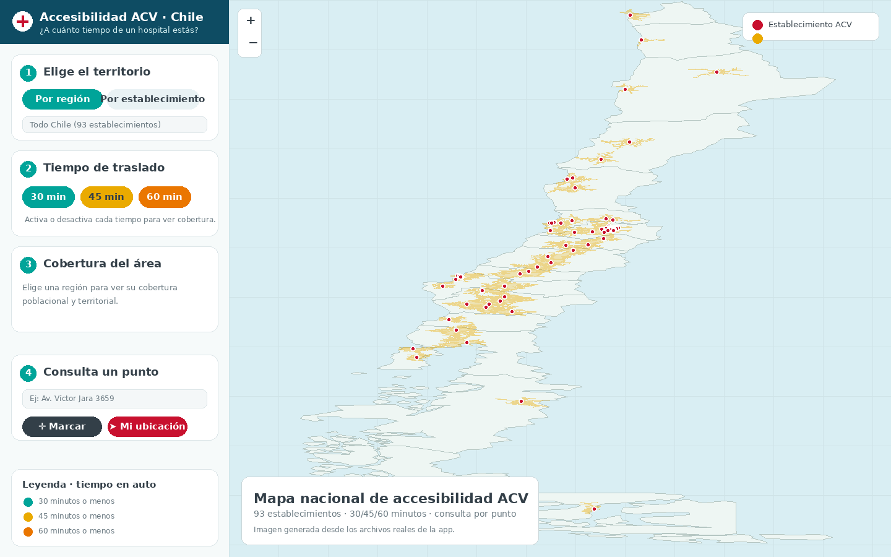
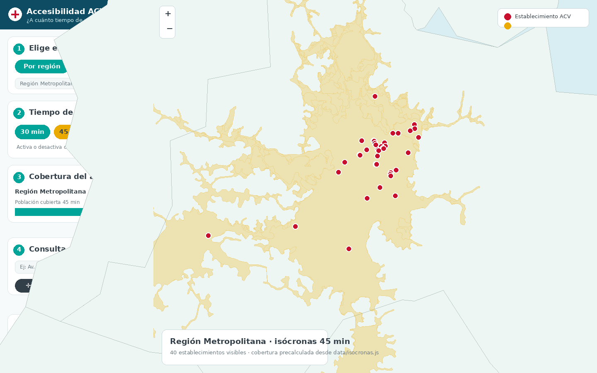
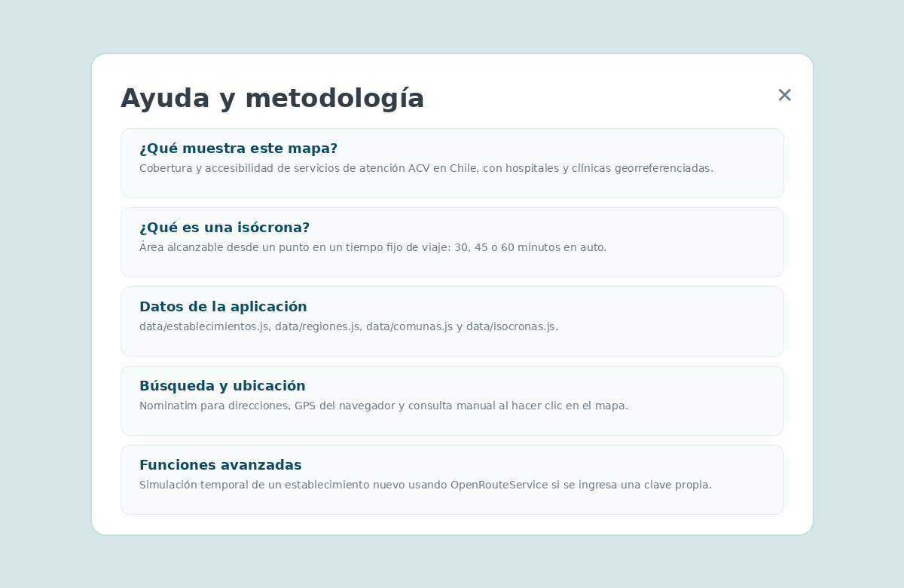
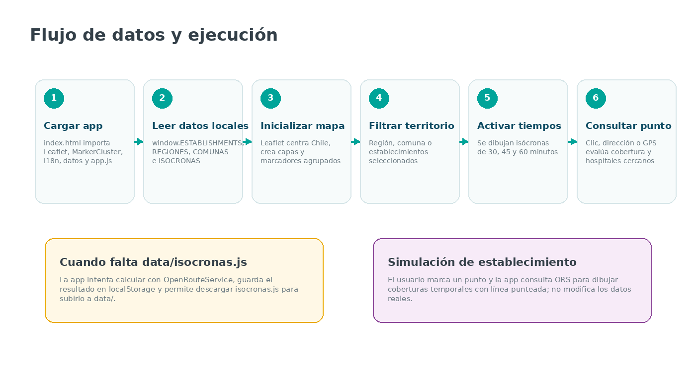
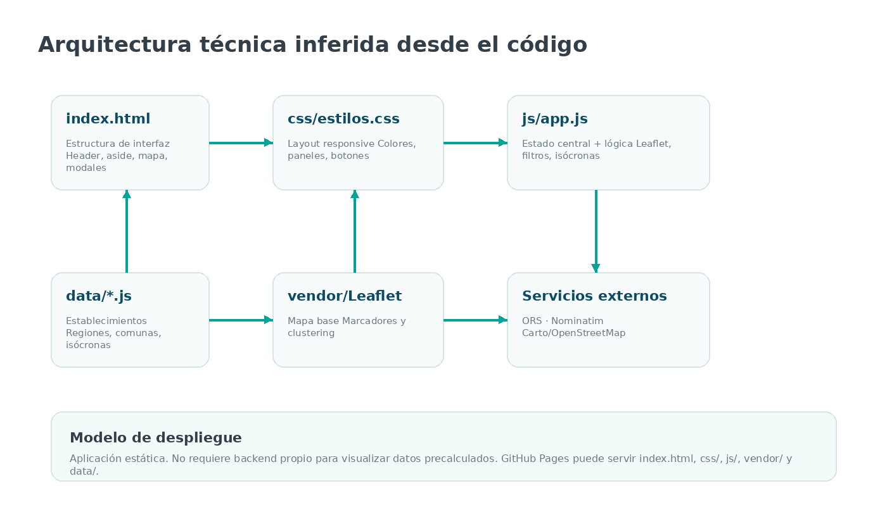

# StrokeAccessCL

<p align="center">
  
</p>

<p align="center">
  <b>Mapa interactivo de accesibilidad hospitalaria para atención de ataque cerebrovascular en Chile</b><br>
  <b>Interactive web map for stroke-care hospital accessibility in Chile</b><br>
  <b>Mapa interativo de acessibilidade hospitalar para atendimento de AVC no Chile</b>
</p>

<p align="center">
  <a href="#español">Español</a> ·
  <a href="#english">English</a> ·
  <a href="#português">Português</a> ·
  <a href="https://mvillalobosc.diinf.usach.cl/StrokeAccessCL/">Aplicación web / Web application / Aplicação web</a>
</p>

<p align="center">
  
</p>

---

## Español

### 1. ¿Qué es StrokeAccessCL?

**StrokeAccessCL** es una aplicación web estática para visualizar la accesibilidad geográfica a los establecimientos que atienden el ataque cerebrovascular (ACV) en Chile. La interfaz permite explorar establecimientos, regiones, comunas, coberturas según el tiempo de traslado e información contextual a través de un mapa interactivo.

La aplicación está implementada como un sitio web del lado del cliente. No requiere un backend propio para visualizar los datos ya incluidos en el repositorio. El navegador carga archivos JavaScript locales con establecimientos, límites administrativos e isócronas precalculadas, y usa Leaflet para dibujar el mapa.

Despliegue público actual: [https://mvillalobosc.diinf.usach.cl/StrokeAccessCL/](https://mvillalobosc.diinf.usach.cl/StrokeAccessCL/)

El proyecto hermano [StrokeAccessRM](../StrokeAccessRM/) trabaja a escala de zona censal en la Región Metropolitana de Santiago. Los dos visores traen copias idénticas de Leaflet 1.9.4 y Leaflet.markercluster, pero cada uno tiene sus propios datos y su propio código.

### 2. Funcionalidades principales

- Visualiza **93 establecimientos** con atención ACV georreferenciados en Chile.
- Permite filtrar por **región**, **comuna con establecimiento** o **establecimiento específico**.
- Muestra coberturas de viaje en auto para **30, 45 y 60 minutos**.
- Usa isócronas precalculadas desde `data/isocronas.js` cuando estén disponibles.
- Permite consultar un punto mediante clic en el mapa, la búsqueda de direcciones o la geolocalización del navegador.
- Informa de hospitales cercanos al punto consultado y entrega enlaces de ruta en Google Maps.
- Incluye una función avanzada para simular un nuevo establecimiento con OpenRouteService.
- Permite descargar los establecimientos en formato CSV y las coberturas en formato `isocronas.js`.
- Soporta las interfaces en **español**, **inglés** y **portugués** mediante `js/i18n.js`.

### 3. Estructura del repositorio

Dentro del repositorio Lab2IA, la aplicación vive en la carpeta `StrokeAccessCL/` y todas sus rutas son relativas a esa carpeta.

```text
.
├── index.html
├── README.md
├── CITATION.cff
├── LICENSE
├── package.json
├── generar_isocronas.mjs
├── assets/
│   ├── README.md
│   ├── screenshot-main.png
│   ├── screenshot-region.png
│   ├── screenshot-help.png
│   ├── architecture-code.png
│   ├── pipeline-code.png
│   └── logo.svg
├── css/
│   ├── README.md
│   └── estilos.css
├── js/
│   ├── README.md
│   ├── app.js
│   └── i18n.js
├── data/
│   ├── README.md
│   ├── establecimientos.js
│   ├── regiones.js
│   ├── comunas.js
│   └── isocronas.js
└── vendor/
    ├── README.md
    ├── leaflet.css
    ├── leaflet.js
    ├── MarkerCluster.css
    └── leaflet.markercluster.js
```

| Archivo o carpeta | Rol |
|---|---|
| `index.html` | Define la estructura de la interfaz: encabezado, panel lateral, mapa, bienvenida y ayuda. |
| `css/estilos.css` | Contiene el diseño visual, los colores, las tarjetas, el panel lateral, los modales y la respuesta móvil. |
| `js/app.js` | Contiene la lógica principal: estado, mapa Leaflet, filtros, isócronas, consulta de puntos, simulación y descargas. |
| `js/i18n.js` | Diccionario multilingüe usado por la interfaz, con 187 claves en cada idioma. |
| `data/establecimientos.js` | Lista de establecimientos con coordenadas, región, comuna, código e identificador interno. |
| `data/regiones.js` | Capa GeoJSON de regiones usada para filtros y encuadre del mapa. |
| `data/comunas.js` | Capa GeoJSON de comunas usada para filtros y consulta territorial. |
| `data/isocronas.js` | Coberturas precalculadas para 30, 45 y 60 minutos por establecimiento. |
| `vendor/` | Dependencias locales de Leaflet y MarkerCluster. |
| `generar_isocronas.mjs` | Script de Node 18 o superior que pide las isócronas a OpenRouteService y escribe `data/isocronas.js` (sección 13.3). |
| `package.json` | Define `npm run start` y `npm run start:py`, que levantan un servidor estático con Python; no declara dependencias. |
| `CITATION.cff` | Metadatos de cita del proyecto (sección 16). |
| `LICENSE` | Condiciones de uso del paquete (sección 18). |
| `assets/` | Logo, capturas y diagramas que usa este README; la aplicación no carga ninguno. |

Cada carpeta tiene un README propio con el detalle de sus archivos: [assets/](assets/README.md), [css/](css/README.md), [data/](data/README.md), [js/](js/README.md) y [vendor/](vendor/README.md).

El repositorio Lab2IA tiene un `.gitignore` en su raíz que ignora `StrokeAccessCL/isocronas_progreso.json`, el archivo de avance que deja `generar_isocronas.mjs` mientras trabaja.

### 4. Capturas / Screenshots / Capturas

| Vista principal | Región con isócronas |
|---|---|
|  |  |

| Ayuda de la aplicación | Flujo de ejecución |
|---|---|
|  |  |

Las imágenes de este README se prepararon desde los archivos reales de la aplicación entregada: `index.html`, `css/`, `js/` y `data/`. No se usaron capturas ni figuras de la memoria escrita.

### 5. Manual de uso

#### 5.1 Elegir territorio

El panel lateral permite trabajar en dos modos:

| Modo | Uso |
|---|---|
| **Por región / comuna** | Filtra el mapa por región y luego por comuna que contiene al menos un establecimiento. |
| **Por establecimiento** | Permite buscar establecimientos por nombre o comuna y mostrar solo los seleccionados. |

Al elegir una región, la aplicación centra el mapa sobre el territorio correspondiente y actualiza el panel de cobertura.

#### 5.2 Activar tiempos de traslado

Los botones **30 min**, **45 min** y **60 min** activan o desactivan las capas de isócronas. Cada isócrona representa el área desde la cual se alcanza un establecimiento con atención ACV en ese tiempo de viaje en auto.

| Tiempo | Color usado por la app | Uso principal |
|---|---|---|
| 30 minutos | Verde azulado `#00A499` | Cobertura cercana. |
| 45 minutos | Amarillo `#EAAA00` | Tiempo de referencia principal usado en el panel. |
| 60 minutos | Naranjo `#EA7600` | Cobertura ampliada. |

#### 5.3 Ver cobertura del área

El paso 3 del panel muestra tarjetas de cobertura. El contenido cambia según el contexto:

- Si no hay región seleccionada, muestra el resumen nacional.
- Si hay región seleccionada, muestra cobertura regional.
- Si hay comuna seleccionada, estima cobertura comunal con las geometrías disponibles.
- Si hay un establecimiento destacado, muestra información del establecimiento, comuna, región y cobertura asociada.

Los porcentajes regionales y los indicadores de salud regionales son resultados de la memoria de título que están escritos en `js/app.js`: las constantes `COBERTURA_REGIONAL`, `POB_CUBIERTA` y `SALUD_REGIONAL` corresponden a las tablas 5.1, 5.2 y A.6, esta última con datos de CASEN 2022. La cifra nacional se obtiene ponderando esas tablas por población y superficie, y la aplicación no recalcula ninguna de ellas a partir de las isócronas. La cifra comunal sí se calcula en el navegador: la aplicación sortea hasta 420 puntos al azar dentro de la comuna y cuenta cuántos caen en alguna isócrona de 45 minutos de los establecimientos de su región, así que el resultado puede variar levemente entre una consulta y otra.

#### 5.4 Consultar un punto

La aplicación permite consultar un punto de tres formas:

1. Escribir una dirección en el buscador.
2. Usar el botón **Mi ubicación**.
3. Usar **Marcar en el mapa** y hacer clic sobre el punto de interés.

Luego, la aplicación revisa si el punto cae dentro de alguna isócrona activa o cargada y lista los hospitales más cercanos usando distancia en línea recta. Para navegación práctica, entrega enlaces a Google Maps.

#### 5.5 Simular un establecimiento nuevo

En **Funciones avanzadas**, el usuario puede marcar un punto como si ahí existiera un nuevo establecimiento con atención ACV. La aplicación consulta OpenRouteService y dibuja coberturas temporales para 30, 45 y 60 minutos.

Esta simulación:

- No se guarda en `data/establecimientos.js`.
- No modifica las isócronas reales.
- Usa línea punteada y colores por tiempo.
- Usa la clave de OpenRouteService que el usuario ingresó en la ayuda (sección 10).

### 6. Arquitectura técnica / Technical architecture / Arquitetura técnica

<p align="center">
  
</p>

StrokeAccessCL es una aplicación web estática. Su ejecución ocurre en el navegador:

```text
Browser
  │
  ├── index.html
  │     ├── header
  │     ├── sidebar controls
  │     ├── Leaflet map container
  │     ├── welcome overlay
  │     └── help/methodology overlay
  │
  ├── css/estilos.css
  │     ├── layout
  │     ├── responsive rules
  │     ├── buttons/cards/modals
  │     └── colour system
  │
  ├── js/i18n.js
  │     └── ES / EN / PT interface strings
  │
  ├── data/*.js
  │     ├── establishments
  │     ├── regions
  │     ├── comunas
  │     └── precomputed isochrones
  │
  └── js/app.js
        ├── application state
        ├── Leaflet map setup
        ├── marker clustering
        ├── isochrone drawing
        ├── region/comuna/facility filters
        ├── point evaluation
        ├── simulated facility mode
        └── CSV / isochrone downloads
```

### 7. Estado central de ejecución

La aplicación usa un objeto de estado en `js/app.js`. La estructura conceptual es:

```javascript
const S = {
  region: '',
  comuna: '',
  filtroHosp: new Set(),
  activos: {30: false, 45: false, 60: false},
  iso: {},
  capas: {},
  sel: null,
  cargando: null,
  puntoModo: false,
  simModo: false,
  sim: null,
  nacional: null,
  nacionalSalud: null,
  ultimoPunto: null
};
```

Este estado separa filtros territoriales, tiempos activos, geometrías de isócronas, capas dibujadas, establecimiento destacado, modo de consulta por punto, modo de simulación y el último punto consultado (`ultimoPunto`), que la aplicación vuelve a evaluar cuando cambian las coberturas o el idioma.

### 8. Flujo de datos

<p align="center">
  
</p>

El flujo principal es:

```text
Abrir index.html
  ↓
Cargar Leaflet, MarkerCluster, i18n y data/*.js
  ↓
Inicializar mapa y marcadores
  ↓
Leer isócronas precalculadas desde data/isocronas.js
  ↓
Aplicar filtros por región, comuna o establecimiento
  ↓
Activar capas de 30, 45 o 60 minutos
  ↓
Consultar punto, geolocalización o simulación
```

Si `data/isocronas.js` no existe o le faltan establecimientos, la aplicación calcula las coberturas que faltan con OpenRouteService, en lotes de tres establecimientos. Cada cobertura calculada queda guardada en `localStorage` con la clave `iso_<id>` y, cuando están todas, se puede descargar como un nuevo `isocronas.js` desde la ventana de ayuda.

La aplicación guarda en `localStorage` estas claves: `acv_key` (clave propia de OpenRouteService), `acv_bienv` (no volver a mostrar la bienvenida), `acv_lang` (idioma elegido) e `iso_<id>` (coberturas calculadas en vivo). Para empezar de cero basta con borrar el almacenamiento del sitio en el navegador. Si el navegador bloquea este almacenamiento, la aplicación igual abre y funciona, pero no recuerda nada entre visitas, y la clave que se escribe en la ayuda se usa solo mientras la página siga abierta, así que hay que volver a escribirla en cada visita.

### 9. APIs y dependencias externas

| Servicio | Uso en la app | Archivo donde aparece |
|---|---|---|
| Leaflet | Renderizado del mapa y capas GeoJSON. | `vendor/leaflet.js`, `js/app.js` |
| Leaflet MarkerCluster | Agrupación visual de marcadores. | `vendor/leaflet.markercluster.js` |
| OpenStreetMap | Teselas del mapa base, pedidas a `tile.openstreetmap.org`. | `js/app.js` |
| OpenRouteService | Cálculo de isócronas para coberturas y simulaciones. | `js/app.js`, `generar_isocronas.mjs` |
| Nominatim / OpenStreetMap | Búsqueda de direcciones en Chile. | `js/app.js` |
| Google Maps | Enlaces externos de ruta. | `js/app.js` |
| Google Fonts | Tipografía Bebas Neue de los títulos; sin conexión, el navegador usa una tipografía de reemplazo. | `index.html` |
| Sitio del DIINF (`informatica.usach.cl`) | Logo del encabezado; si no carga, la página lo oculta. | `index.html` |

### 10. Clave de OpenRouteService

El código no trae ninguna clave de OpenRouteService. La aplicación usa la clave que cada usuario ingresa en la ayuda y la guarda en su navegador (`acv_key` en `localStorage`); sin clave, o si la clave agota su límite diario, OpenRouteService rechaza la petición y la aplicación muestra un aviso que pide ingresar una. `generar_isocronas.mjs` lee la clave de la variable de entorno `ORS_KEY` y se detiene con un mensaje si no está definida.

La visualización normal funciona con `data/isocronas.js` y no consulta OpenRouteService. Para recalcular coberturas o usar la simulación de establecimientos hay que ingresar una clave propia (se obtiene gratis en openrouteservice.org) en:

```text
Ayuda y metodología → OpenRouteService key
```

La clave se guarda solo en el navegador mediante `localStorage`, con el nombre `acv_key`.

### 11. Ejecución local

No se necesita instalar dependencias para ver la app. Basta con servir la carpeta como sitio estático. La página también abre con doble clic en `index.html`, porque los datos son archivos `.js` que se cargan con etiquetas `<script>`; para probar el GPS conviene usar `http://localhost`.

Con Python 3:

```bash
python3 -m http.server 8000
```

Luego abre:

```text
http://localhost:8000/
```

También puedes usar el script definido en `package.json`:

```bash
npm run start
```

### 12. Despliegue manual en GitHub Pages

1. Crea un repositorio vacío en GitHub.
2. Copia el contenido de la carpeta `StrokeAccessCL/`, no la carpeta misma.
3. Sube ese contenido a la raíz del repositorio nuevo.
4. Verifica que `index.html` y `README.md` queden en la raíz.
5. En GitHub, entra a:

```text
Settings → Pages → Build and deployment
```

6. Configura:

```text
Source: Deploy from a branch
Branch: main
Folder: /root
```

7. Guarda la configuración.

GitHub Pages publicará la app usando `index.html`. El README se verá automáticamente en la página principal del repositorio.

### 13. Mantención de datos

#### 13.1 Actualizar establecimientos

Edita `data/establecimientos.js`. Cada registro debe mantener esta estructura:

```javascript
{
  code: 101100,
  name: "Hospital Dr Juan Noé Crevanni (Arica)",
  lat: -18.482478,
  lon: -70.312948,
  comuna: "Arica",
  provincia: "Arica",
  region: "Región de Arica y Parinacota",
  cod_comuna: 15101,
  codregion: 15,
  id: 1
}
```

Reglas prácticas:

- `id` debe ser único.
- `lat` y `lon` deben estar en WGS84.
- `codregion` debe coincidir con `data/regiones.js`.
- `cod_comuna` debe coincidir con `data/comunas.js`.
- Si agregas un establecimiento, también debes generar sus isócronas.

Si cambia la cantidad de establecimientos, también hay que corregir a mano la cifra 93, que aparece escrita en 18 textos de `js/i18n.js` (6 por idioma), en 3 textos de `index.html` y en el encabezado que `descargarIsocronas` escribe en `js/app.js`. Las tablas de resultados de la memoria (`COBERTURA_REGIONAL`, `POB_CUBIERTA` y `SALUD_REGIONAL` en `js/app.js`) no cambian al agregar establecimientos: si los resultados regionales cambian, hay que editarlas.

#### 13.2 Actualizar límites territoriales

Los archivos `data/regiones.js` y `data/comunas.js` deben exponer objetos GeoJSON en variables globales:

```javascript
window.REGIONES = {...};
window.COMUNAS = {...};
```

La app usa estos polígonos para encuadrar el mapa, filtrar comunas y determinar en qué comuna cae un punto consultado. Cada región lleva las propiedades `codregion` y `Region`; cada comuna lleva `cod_comuna`, `codregion`, `Comuna`, `Provincia` y `Region`.

#### 13.3 Regenerar isócronas

Las coberturas se guardan en:

```text
data/isocronas.js
```

Formato esperado:

```javascript
window.ISOCRONAS = {
  "1": {
    "30": { "type": "Polygon", "coordinates": [...] },
    "45": { "type": "Polygon", "coordinates": [...] },
    "60": { "type": "Polygon", "coordinates": [...] }
  }
};
```

Para regenerarlas puedes usar la app o el script `generar_isocronas.mjs`. Si usas la app, al terminar la preparación descarga `isocronas.js` desde la ventana de ayuda y súbelo a `data/`. El archivo que trae hoy el repositorio se descargó así: su encabezado dice «Generado desde la app».

El script necesita Node 18 o superior y una clave propia de OpenRouteService en la variable `ORS_KEY` (la del proyecto va cifrada en [`claves.zip`](../claves.zip), en la raíz del repositorio), y se corre desde la carpeta `StrokeAccessCL/`:

```bash
ORS_KEY=tu_clave node generar_isocronas.mjs
```

El script lee `data/establecimientos.js`, pide a OpenRouteService (perfil `driving-car`, rangos de 1800, 2700 y 3600 segundos) las coberturas de tres establecimientos por petición y espera entre lotes para no pasar el límite por minuto; si la API responde 429, espera 25 segundos y reintenta. La variable `ORS_URL` permite apuntar a otro servidor de OpenRouteService. Después de cada lote guarda el avance en `isocronas_progreso.json`, de modo que si se corta basta con volver a correrlo para que retome. Al terminar escribe `data/isocronas.js` con la fecha en el encabezado, avisa qué establecimientos quedaron sin los tres tiempos y borra el archivo de avance.

### 14. Checklist antes de publicar

- [ ] `index.html` abre correctamente.
- [ ] `README.md` se ve en GitHub con las imágenes de `assets/`.
- [ ] El código no trae claves de OpenRouteService ni de otros servicios.
- [ ] `data/establecimientos.js` carga 93 establecimientos o el número actualizado esperado.
- [ ] `data/isocronas.js` contiene coberturas para los establecimientos vigentes.
- [ ] Los filtros de región y comuna funcionan.
- [ ] Los botones 30/45/60 dibujan coberturas.
- [ ] El buscador de dirección responde con conexión a internet.
- [ ] La geolocalización se prueba desde `https` o `localhost`.
- [ ] GitHub Pages está configurado en `main / root`.

### 15. Limitaciones conocidas

- Las isócronas dependen de la red vial y del servicio OpenRouteService cuando se recalculan.
- El GPS del navegador requiere `https` o `localhost`.
- La búsqueda de direcciones depende de Nominatim y de conexión a internet.
- La cobertura comunal en línea se estima con un muestreo aleatorio de puntos: puede cambiar levemente entre consultas y no reemplaza una estimación censal completa.
- Si se agregan nuevos establecimientos, deben actualizarse también las coberturas.
- En árboles de datos muy pesados o muchas geometrías activas, el navegador puede tardar más en renderizar.

### 16. Cita sugerida

Guajardo Arias, I. A., Villalobos Cid, M. J., & Giglio Gutiérrez, J. (2025). *Implementación de un sistema de visualización para el análisis espacio-temporal de la cobertura hospitalaria y la accesibilidad de los servicios de atención para el ataque cerebrovascular a nivel nacional en Chile*. Universidad de Santiago de Chile, Facultad de Ingeniería, Departamento de Ingeniería Informática.

La metadata para GitHub también está disponible en `CITATION.cff`.

### 17. Créditos

Trabajo asociado a la Universidad de Santiago de Chile, Facultad de Ingeniería, Departamento de Ingeniería Informática.

Autores reconocidos en la cita del proyecto:

| Autor | Rol |
|---|---|
| Iván Alejandro Guajardo Arias | Desarrollo original de la herramienta y memoria asociada. |
| Manuel José Villalobos Cid | Profesor guía / colaboración académica. |
| Juan Giglio Gutiérrez | Profesor co-guía / colaboración académica. |

Nota de preparación del repositorio: este paquete fue organizado con apoyo de ChatGPT para dejar una estructura publicable en GitHub. Además de este README, cada carpeta (`assets/`, `css/`, `data/`, `js/` y `vendor/`) tiene un `README.md` que describe sus archivos.

### 18. Licencia

El archivo `LICENSE` no es una licencia de código abierto estándar. Dice que, mientras el dueño del repositorio no agregue una licencia abierta, todos los derechos quedan en manos de los autores. Permite usar el repositorio para revisión académica, demostraciones docentes y reproducibilidad de la aplicación, siempre con atribución, y pide contactar a los autores antes de reutilizar, redistribuir o crear obras derivadas. Leaflet y Leaflet.markercluster, en `vendor/`, mantienen sus propias licencias ([vendor/README.md](vendor/README.md)).

---

## English

### 1. What is StrokeAccessCL?

**StrokeAccessCL** is a static web application for visualising geographic accessibility to facilities that provide stroke care in Chile. Its interface allows users to explore facilities, regions, communes, travel-time coverage and contextual information through an interactive map.

The application is implemented as a client-side website. It does not require a dedicated backend to display the data already included in the repository. The browser loads local JavaScript files containing facilities, administrative boundaries and precomputed isochrones, and uses Leaflet to render the map.

Current public deployment: [https://mvillalobosc.diinf.usach.cl/StrokeAccessCL/](https://mvillalobosc.diinf.usach.cl/StrokeAccessCL/)

The sibling project [StrokeAccessRM](../StrokeAccessRM/) works at census-zone level in the Santiago Metropolitan Region. Both viewers bundle identical copies of Leaflet 1.9.4 and Leaflet.markercluster, but each one has its own data and its own code.

### 2. Main features

- Displays **93 georeferenced stroke-care facilities** in Chile.
- Allows filtering by **region**, **commune with at least one facility**, or **specific facility**.
- Shows car travel-time coverage for **30, 45 and 60 minutes**.
- Uses precomputed isochrones from `data/isocronas.js` when available.
- Allows users to query a point by clicking on the map, searching for an address or using browser geolocation.
- Reports hospitals near the queried point and provides route links in Google Maps.
- Includes an advanced function for simulating a new facility with OpenRouteService.
- Allows facilities to be downloaded in CSV format and coverage data in `isocronas.js` format.
- Supports **Spanish**, **English** and **Portuguese** interfaces through `js/i18n.js`.

### 3. Repository structure

Inside the Lab2IA repository, the application lives in the `StrokeAccessCL/` folder and all its paths are relative to that folder.

```text
.
├── index.html
├── README.md
├── CITATION.cff
├── LICENSE
├── package.json
├── generar_isocronas.mjs
├── assets/
│   ├── README.md
│   ├── screenshot-main.png
│   ├── screenshot-region.png
│   ├── screenshot-help.png
│   ├── architecture-code.png
│   ├── pipeline-code.png
│   └── logo.svg
├── css/
│   ├── README.md
│   └── estilos.css
├── js/
│   ├── README.md
│   ├── app.js
│   └── i18n.js
├── data/
│   ├── README.md
│   ├── establecimientos.js
│   ├── regiones.js
│   ├── comunas.js
│   └── isocronas.js
└── vendor/
    ├── README.md
    ├── leaflet.css
    ├── leaflet.js
    ├── MarkerCluster.css
    └── leaflet.markercluster.js
```

| File or directory | Role |
|---|---|
| `index.html` | Defines the interface structure: header, sidebar, map, welcome screen and help panel. |
| `css/estilos.css` | Contains the visual design, colours, cards, sidebar, modals and responsive behaviour. |
| `js/app.js` | Contains the main logic: state, Leaflet map, filters, isochrones, point queries, simulation and downloads. |
| `js/i18n.js` | Multilingual dictionary used by the interface, with 187 keys per language. |
| `data/establecimientos.js` | List of facilities with coordinates, region, commune, code and internal identifier. |
| `data/regiones.js` | GeoJSON region layer used for filtering and map framing. |
| `data/comunas.js` | GeoJSON commune layer used for filtering and territorial queries. |
| `data/isocronas.js` | Precomputed 30, 45 and 60 minute coverage for each facility. |
| `vendor/` | Local Leaflet and MarkerCluster dependencies. |
| `generar_isocronas.mjs` | Node 18 (or newer) script that requests the isochrones from OpenRouteService and writes `data/isocronas.js` (section 13.3). |
| `package.json` | Defines `npm run start` and `npm run start:py`, which start a static server with Python; it declares no dependencies. |
| `CITATION.cff` | Citation metadata for the project (section 16). |
| `LICENSE` | Terms of use of the package (section 18). |
| `assets/` | Logo, screenshots and diagrams used by this README; the application loads none of them. |

Each folder has its own README with details on its files: [assets/](assets/README.md), [css/](css/README.md), [data/](data/README.md), [js/](js/README.md) and [vendor/](vendor/README.md).

The Lab2IA repository has a `.gitignore` at its root that ignores `StrokeAccessCL/isocronas_progreso.json`, the progress file that `generar_isocronas.mjs` keeps while it runs.

### 4. Screenshots

| Main view | Region with isochrones |
|---|---|
|  |  |

| Application help | Runtime flow |
|---|---|
|  |  |

The images in this README were prepared from the actual application files provided: `index.html`, `css/`, `js/` and `data/`. No screenshots or figures from the written thesis were used.

### 5. User guide

#### 5.1 Select a territory

The sidebar supports two working modes:

| Mode | Use |
|---|---|
| **By region / commune** | Filters the map first by region and then by a commune containing at least one facility. |
| **By facility** | Allows facilities to be searched by name or commune and displays only the selected facilities. |

When a region is selected, the application centres the map on the corresponding territory and updates the coverage panel.

#### 5.2 Activate travel times

The **30 min**, **45 min** and **60 min** buttons enable or disable the isochrone layers. Each isochrone represents the area from which a stroke-care facility can be reached within that car travel time.

| Time | Colour used by the app | Main use |
|---|---|---|
| 30 minutes | Teal `#00A499` | Nearby coverage. |
| 45 minutes | Yellow `#EAAA00` | Main reference time used in the panel. |
| 60 minutes | Orange `#EA7600` | Extended coverage. |

#### 5.3 View area coverage

Step 3 of the sidebar displays coverage cards. Their content changes according to the current context:

- If no region is selected, it displays the national summary.
- If a region is selected, it displays regional coverage.
- If a commune is selected, it estimates commune-level coverage using the available geometries.
- If a facility is highlighted, it displays information about the facility, commune, region and associated coverage.

The regional percentages and the regional health indicators are results of the undergraduate thesis written into `js/app.js`: the constants `COBERTURA_REGIONAL`, `POB_CUBIERTA` and `SALUD_REGIONAL` correspond to tables 5.1, 5.2 and A.6, the last one with CASEN 2022 data. The national figure is obtained by weighting those tables by population and area, and the application does not recompute any of them from the isochrones. The commune figure is computed in the browser: the application draws up to 420 random points inside the commune and counts how many fall within any 45 minute isochrone of the facilities in its region, so the result can vary slightly from one query to the next.

#### 5.4 Query a point

The application allows a point to be queried in three ways:

1. Enter an address in the search box.
2. Use the **My location** button.
3. Use **Mark on map** and click the point of interest.

The application then checks whether the point falls inside any active or loaded isochrone and lists the nearest hospitals using straight-line distance. For practical navigation, it provides links to Google Maps.

#### 5.5 Simulate a new facility

Under **Advanced functions**, the user can mark a point as though a new stroke-care facility existed at that location. The application queries OpenRouteService and draws temporary 30, 45 and 60 minute coverage areas.

This simulation:

- Is not saved in `data/establecimientos.js`.
- Does not modify the real isochrones.
- Uses dashed lines and time-specific colours.
- Uses the OpenRouteService key that the user entered in the help window (section 10).

### 6. Technical architecture

<p align="center">
  
</p>

StrokeAccessCL is a static web application. It runs entirely in the browser:

```text
Browser
  │
  ├── index.html
  │     ├── header
  │     ├── sidebar controls
  │     ├── Leaflet map container
  │     ├── welcome overlay
  │     └── help/methodology overlay
  │
  ├── css/estilos.css
  │     ├── layout
  │     ├── responsive rules
  │     ├── buttons/cards/modals
  │     └── colour system
  │
  ├── js/i18n.js
  │     └── ES / EN / PT interface strings
  │
  ├── data/*.js
  │     ├── establishments
  │     ├── regions
  │     ├── communes
  │     └── precomputed isochrones
  │
  └── js/app.js
        ├── application state
        ├── Leaflet map setup
        ├── marker clustering
        ├── isochrone drawing
        ├── region/commune/facility filters
        ├── point evaluation
        ├── simulated facility mode
        └── CSV / isochrone downloads
```

### 7. Central runtime state

The application uses a state object in `js/app.js`. Its conceptual structure is:

```javascript
const S = {
  region: '',
  comuna: '',
  filtroHosp: new Set(),
  activos: {30: false, 45: false, 60: false},
  iso: {},
  capas: {},
  sel: null,
  cargando: null,
  puntoModo: false,
  simModo: false,
  sim: null,
  nacional: null,
  nacionalSalud: null,
  ultimoPunto: null
};
```

This state separates territorial filters, active travel times, isochrone geometries, rendered layers, the highlighted facility, point-query mode, simulation mode and the last queried point (`ultimoPunto`), which the application evaluates again when the coverage or the language changes.

### 8. Data flow

<p align="center">
  
</p>

The main flow is:

```text
Open index.html
  ↓
Load Leaflet, MarkerCluster, i18n and data/*.js
  ↓
Initialise the map and markers
  ↓
Read precomputed isochrones from data/isocronas.js
  ↓
Apply filters by region, commune or facility
  ↓
Activate 30, 45 or 60 minute layers
  ↓
Query a point, use geolocation or run a simulation
```

If `data/isocronas.js` does not exist or lacks some facilities, the application computes the missing coverage with OpenRouteService, in batches of three facilities. Each computed coverage is stored in `localStorage` under the key `iso_<id>` and, once all of them are available, it can be downloaded as a new `isocronas.js` file from the help window.

The application stores these keys in `localStorage`: `acv_key` (the user's own OpenRouteService key), `acv_bienv` (do not show the welcome screen again), `acv_lang` (selected language) and `iso_<id>` (coverage computed live). Clearing the site storage in the browser resets all of them. If the browser blocks this storage, the application still opens and works, but it remembers nothing between visits, and the key typed in the help window is used only while the page stays open, so it has to be typed again on each visit.

### 9. APIs and external dependencies

| Service | Use in the app | File where it appears |
|---|---|---|
| Leaflet | Rendering the map and GeoJSON layers. | `vendor/leaflet.js`, `js/app.js` |
| Leaflet MarkerCluster | Visual grouping of markers. | `vendor/leaflet.markercluster.js` |
| OpenStreetMap | Base-map tiles, requested from `tile.openstreetmap.org`. | `js/app.js` |
| OpenRouteService | Isochrone calculation for coverage and simulations. | `js/app.js`, `generar_isocronas.mjs` |
| Nominatim / OpenStreetMap | Address search in Chile. | `js/app.js` |
| Google Maps | External route links. | `js/app.js` |
| Google Fonts | Bebas Neue typeface for headings; without a connection the browser uses a fallback typeface. | `index.html` |
| DIINF website (`informatica.usach.cl`) | Header logo; if it does not load, the page hides it. | `index.html` |

### 10. OpenRouteService key

The code does not ship any OpenRouteService key. The application uses the key each user enters in the help window and stores it in their browser (`acv_key` in `localStorage`); without a key, or when the key reaches its daily limit, OpenRouteService rejects the request and the application shows a notice asking for one. `generar_isocronas.mjs` reads the key from the `ORS_KEY` environment variable and stops with a message when it is not set.

Normal visualisation works with `data/isocronas.js` and does not query OpenRouteService. To recalculate coverage or use facility simulation, you need to enter your own key (free at openrouteservice.org) under:

```text
Help and methodology → OpenRouteService key
```

The key is stored only in the browser through `localStorage`, under the name `acv_key`.

### 11. Local execution

No dependencies need to be installed to view the application. The directory only needs to be served as a static website. The page also opens by double-clicking `index.html`, because the data are `.js` files loaded through `<script>` tags; to test GPS, use `http://localhost`.

With Python 3:

```bash
python3 -m http.server 8000
```

Then open:

```text
http://localhost:8000/
```

You can also use the script defined in `package.json`:

```bash
npm run start
```

### 12. Manual deployment to GitHub Pages

1. Create an empty repository on GitHub.
2. Copy the contents of the `StrokeAccessCL/` folder, not the folder itself.
3. Upload those contents to the root of the new repository.
4. Check that `index.html` and `README.md` are in the root directory.
5. In GitHub, open:

```text
Settings → Pages → Build and deployment
```

6. Configure:

```text
Source: Deploy from a branch
Branch: main
Folder: /root
```

7. Save the configuration.

GitHub Pages will publish the application using `index.html`. The README will appear automatically on the repository landing page.

### 13. Data maintenance

#### 13.1 Update facilities

Edit `data/establecimientos.js`. Each record must keep the following structure:

```javascript
{
  code: 101100,
  name: "Hospital Dr Juan Noé Crevanni (Arica)",
  lat: -18.482478,
  lon: -70.312948,
  comuna: "Arica",
  provincia: "Arica",
  region: "Región de Arica y Parinacota",
  cod_comuna: 15101,
  codregion: 15,
  id: 1
}
```

Practical rules:

- `id` must be unique.
- `lat` and `lon` must use WGS84 coordinates.
- `codregion` must match `data/regiones.js`.
- `cod_comuna` must match `data/comunas.js`.
- When a facility is added, its isochrones must also be generated.

If the number of facilities changes, the figure 93 must also be edited by hand: it is written in 18 strings of `js/i18n.js` (6 per language), in 3 strings of `index.html` and in the header that `descargarIsocronas` writes in `js/app.js`. The thesis result tables (`COBERTURA_REGIONAL`, `POB_CUBIERTA` and `SALUD_REGIONAL` in `js/app.js`) do not change when facilities are added: if the regional results change, those tables must be edited.

#### 13.2 Update territorial boundaries

The `data/regiones.js` and `data/comunas.js` files must expose GeoJSON objects as global variables:

```javascript
window.REGIONES = {...};
window.COMUNAS = {...};
```

The application uses these polygons to frame the map, filter communes and determine which commune contains a queried point. Each region carries the properties `codregion` and `Region`; each commune carries `cod_comuna`, `codregion`, `Comuna`, `Provincia` and `Region`.

#### 13.3 Regenerate isochrones

Coverage data are stored in:

```text
data/isocronas.js
```

Expected format:

```javascript
window.ISOCRONAS = {
  "1": {
    "30": { "type": "Polygon", "coordinates": [...] },
    "45": { "type": "Polygon", "coordinates": [...] },
    "60": { "type": "Polygon", "coordinates": [...] }
  }
};
```

Isochrones can be regenerated using the application or the `generar_isocronas.mjs` script. When using the application, download `isocronas.js` from the help window after preparation is complete and upload it to `data/`. The file currently in the repository was produced that way: its header says "Generado desde la app".

The script needs Node 18 or newer and your own OpenRouteService key in the `ORS_KEY` variable (the project key is stored encrypted in [`claves.zip`](../claves.zip), at the root of the repository), and it runs from the `StrokeAccessCL/` folder:

```bash
ORS_KEY=your_key node generar_isocronas.mjs
```

The script reads `data/establecimientos.js`, asks OpenRouteService (`driving-car` profile, ranges of 1800, 2700 and 3600 seconds) for the coverage of three facilities per request and waits between batches to stay under the per-minute limit; if the API answers 429, it waits 25 seconds and retries. The `ORS_URL` variable points the script to another OpenRouteService server. After each batch it saves its progress in `isocronas_progreso.json`, so if it stops, running it again resumes the work. At the end it writes `data/isocronas.js` with the date in its header, warns about facilities left without all three times and deletes the progress file.

### 14. Checklist before publication

- [ ] `index.html` opens correctly.
- [ ] `README.md` is displayed on GitHub with the images from `assets/`.
- [ ] The code carries no OpenRouteService key or any other service key.
- [ ] `data/establecimientos.js` loads 93 facilities or the expected updated number.
- [ ] `data/isocronas.js` contains coverage for all current facilities.
- [ ] Region and commune filters work correctly.
- [ ] The 30/45/60 buttons draw the coverage layers.
- [ ] The address search works when an internet connection is available.
- [ ] Geolocation is tested through `https` or `localhost`.
- [ ] GitHub Pages is configured to use `main / root`.

### 15. Known limitations

- Isochrones depend on the road network and on OpenRouteService when recalculated.
- Browser GPS requires `https` or `localhost`.
- Address search depends on Nominatim and an internet connection.
- Online commune-level coverage is estimated by random point sampling: it can change slightly between queries and does not replace a complete census-based estimate.
- When new facilities are added, their coverage data must also be updated.
- With very large data trees or many active geometries, the browser may take longer to render the map.

### 16. Suggested citation

Guajardo Arias, I. A., Villalobos Cid, M. J., & Giglio Gutiérrez, J. (2025). *Implementación de un sistema de visualización para el análisis espacio-temporal de la cobertura hospitalaria y la accesibilidad de los servicios de atención para el ataque cerebrovascular a nivel nacional en Chile*. Universidad de Santiago de Chile, Facultad de Ingeniería, Departamento de Ingeniería Informática.

GitHub citation metadata are also available in `CITATION.cff`.

### 17. Credits

Work associated with the Universidad de Santiago de Chile, Faculty of Engineering, Department of Computer Science.

Authors acknowledged in the project citation:

| Author | Role |
|---|---|
| Iván Alejandro Guajardo Arias | Original development of the tool and associated thesis. |
| Manuel José Villalobos Cid | Supervisor / academic collaboration. |
| Juan Giglio Gutiérrez | Co-supervisor / academic collaboration. |

Repository preparation note: this package was organised with support from ChatGPT to provide a GitHub-ready structure. Besides this README, each folder (`assets/`, `css/`, `data/`, `js/` and `vendor/`) has a `README.md` that describes its files.

### 18. Licence

The `LICENSE` file is not a standard open-source licence. It states that, until the repository owner adds an open licence, all rights remain with the authors. It allows the repository to be used for academic review, teaching demonstrations and reproducibility of the application, always with attribution, and asks users to contact the authors before reusing, redistributing or creating derivative works. Leaflet and Leaflet.markercluster, in `vendor/`, keep their own licences ([vendor/README.md](vendor/README.md)).

---

## Português

### 1. O que é o StrokeAccessCL?

**StrokeAccessCL** é uma aplicação web estática para visualizar a acessibilidade geográfica aos estabelecimentos que oferecem atendimento ao acidente vascular cerebral (AVC) no Chile. A interface permite explorar estabelecimentos, regiões, comunas, coberturas conforme o tempo de deslocamento e informações contextuais por meio de um mapa interativo.

A aplicação foi implementada como um site do lado do cliente. Ela não requer um backend próprio para visualizar os dados já incluídos no repositório. O navegador carrega arquivos JavaScript locais com estabelecimentos, limites administrativos e isócronas pré-calculadas, e utiliza o Leaflet para desenhar o mapa.

Implantação pública atual: [https://mvillalobosc.diinf.usach.cl/StrokeAccessCL/](https://mvillalobosc.diinf.usach.cl/StrokeAccessCL/)

O projeto irmão [StrokeAccessRM](../StrokeAccessRM/) trabalha no nível de zona censitária na Região Metropolitana de Santiago. Os dois visualizadores trazem cópias idênticas do Leaflet 1.9.4 e do Leaflet.markercluster, mas cada um tem seus próprios dados e seu próprio código.

### 2. Funcionalidades principais

- Exibe **93 estabelecimentos georreferenciados** com atendimento ao AVC no Chile.
- Permite filtrar por **região**, **comuna com estabelecimento** ou **estabelecimento específico**.
- Mostra coberturas de viagem de carro para **30, 45 e 60 minutos**.
- Utiliza isócronas pré-calculadas de `data/isocronas.js` quando disponíveis.
- Permite consultar um ponto por clique no mapa, busca de endereço ou geolocalização do navegador.
- Informa os hospitais próximos ao ponto consultado e fornece links de rota no Google Maps.
- Inclui uma função avançada para simular um novo estabelecimento com o OpenRouteService.
- Permite baixar os estabelecimentos em formato CSV e as coberturas no formato `isocronas.js`.
- Oferece interfaces em **espanhol**, **inglês** e **português** por meio de `js/i18n.js`.

### 3. Estrutura do repositório

Dentro do repositório Lab2IA, a aplicação fica na pasta `StrokeAccessCL/` e todos os seus caminhos são relativos a essa pasta.

```text
.
├── index.html
├── README.md
├── CITATION.cff
├── LICENSE
├── package.json
├── generar_isocronas.mjs
├── assets/
│   ├── README.md
│   ├── screenshot-main.png
│   ├── screenshot-region.png
│   ├── screenshot-help.png
│   ├── architecture-code.png
│   ├── pipeline-code.png
│   └── logo.svg
├── css/
│   ├── README.md
│   └── estilos.css
├── js/
│   ├── README.md
│   ├── app.js
│   └── i18n.js
├── data/
│   ├── README.md
│   ├── establecimientos.js
│   ├── regiones.js
│   ├── comunas.js
│   └── isocronas.js
└── vendor/
    ├── README.md
    ├── leaflet.css
    ├── leaflet.js
    ├── MarkerCluster.css
    └── leaflet.markercluster.js
```

| Arquivo ou pasta | Função |
|---|---|
| `index.html` | Define a estrutura da interface: cabeçalho, painel lateral, mapa, boas-vindas e ajuda. |
| `css/estilos.css` | Contém o design visual, as cores, os cartões, o painel lateral, os modais e o comportamento responsivo. |
| `js/app.js` | Contém a lógica principal: estado, mapa Leaflet, filtros, isócronas, consulta de pontos, simulação e downloads. |
| `js/i18n.js` | Dicionário multilíngue utilizado pela interface, com 187 chaves em cada idioma. |
| `data/establecimientos.js` | Lista de estabelecimentos com coordenadas, região, comuna, código e identificador interno. |
| `data/regiones.js` | Camada GeoJSON de regiões utilizada para filtros e enquadramento do mapa. |
| `data/comunas.js` | Camada GeoJSON de comunas utilizada para filtros e consultas territoriais. |
| `data/isocronas.js` | Coberturas pré-calculadas de 30, 45 e 60 minutos para cada estabelecimento. |
| `vendor/` | Dependências locais do Leaflet e do MarkerCluster. |
| `generar_isocronas.mjs` | Script para Node 18 ou superior que pede as isócronas ao OpenRouteService e grava `data/isocronas.js` (seção 13.3). |
| `package.json` | Define `npm run start` e `npm run start:py`, que iniciam um servidor estático com Python; não declara dependências. |
| `CITATION.cff` | Metadados de citação do projeto (seção 16). |
| `LICENSE` | Condições de uso do pacote (seção 18). |
| `assets/` | Logo, capturas e diagramas usados neste README; a aplicação não carrega nenhum deles. |

Cada pasta tem um README próprio com o detalhe de seus arquivos: [assets/](assets/README.md), [css/](css/README.md), [data/](data/README.md), [js/](js/README.md) e [vendor/](vendor/README.md).

O repositório Lab2IA tem um `.gitignore` na raiz que ignora `StrokeAccessCL/isocronas_progreso.json`, o arquivo de progresso que `generar_isocronas.mjs` mantém enquanto trabalha.

### 4. Capturas de tela

| Visão principal | Região com isócronas |
|---|---|
|  |  |

| Ajuda da aplicação | Fluxo de execução |
|---|---|
|  |  |

As imagens deste README foram preparadas a partir dos arquivos reais da aplicação fornecida: `index.html`, `css/`, `js/` e `data/`. Não foram utilizadas capturas nem figuras da dissertação escrita.

### 5. Manual de uso

#### 5.1 Selecionar um território

O painel lateral permite trabalhar em dois modos:

| Modo | Uso |
|---|---|
| **Por região / comuna** | Filtra o mapa por região e depois por uma comuna que contenha pelo menos um estabelecimento. |
| **Por estabelecimento** | Permite buscar estabelecimentos por nome ou comuna e mostrar apenas os selecionados. |

Ao selecionar uma região, a aplicação centraliza o mapa no território correspondente e atualiza o painel de cobertura.

#### 5.2 Ativar tempos de deslocamento

Os botões **30 min**, **45 min** e **60 min** ativam ou desativam as camadas de isócronas. Cada isócrona representa a área a partir da qual é possível chegar a um estabelecimento com atendimento ao AVC dentro daquele tempo de viagem de carro.

| Tempo | Cor utilizada pela aplicação | Uso principal |
|---|---|---|
| 30 minutos | Verde-azulado `#00A499` | Cobertura próxima. |
| 45 minutos | Amarelo `#EAAA00` | Principal tempo de referência utilizado no painel. |
| 60 minutos | Laranja `#EA7600` | Cobertura ampliada. |

#### 5.3 Visualizar a cobertura da área

A etapa 3 do painel mostra cartões de cobertura. O conteúdo muda conforme o contexto:

- Se nenhuma região estiver selecionada, mostra o resumo nacional.
- Se uma região estiver selecionada, mostra a cobertura regional.
- Se uma comuna estiver selecionada, estima a cobertura comunal com as geometrias disponíveis.
- Se um estabelecimento estiver destacado, mostra informações sobre o estabelecimento, a comuna, a região e a cobertura associada.

As porcentagens regionais e os indicadores de saúde regionais são resultados da dissertação de graduação escritos em `js/app.js`: as constantes `COBERTURA_REGIONAL`, `POB_CUBIERTA` e `SALUD_REGIONAL` correspondem às tabelas 5.1, 5.2 e A.6, esta última com dados da CASEN 2022. O valor nacional é obtido ponderando essas tabelas por população e superfície, e a aplicação não recalcula nenhuma delas a partir das isócronas. O valor comunal é calculado no navegador: a aplicação sorteia até 420 pontos ao acaso dentro da comuna e conta quantos caem em alguma isócrona de 45 minutos dos estabelecimentos de sua região, por isso o resultado pode variar um pouco de uma consulta para outra.

#### 5.4 Consultar um ponto

A aplicação permite consultar um ponto de três formas:

1. Digitar um endereço no campo de busca.
2. Utilizar o botão **Minha localização**.
3. Utilizar **Marcar no mapa** e clicar no ponto de interesse.

Em seguida, a aplicação verifica se o ponto está dentro de alguma isócrona ativa ou carregada e lista os hospitais mais próximos utilizando distância em linha reta. Para navegação prática, fornece links para o Google Maps.

#### 5.5 Simular um novo estabelecimento

Em **Funções avançadas**, o usuário pode marcar um ponto como se houvesse ali um novo estabelecimento com atendimento ao AVC. A aplicação consulta o OpenRouteService e desenha coberturas temporárias de 30, 45 e 60 minutos.

Essa simulação:

- Não é salva em `data/establecimientos.js`.
- Não modifica as isócronas reais.
- Utiliza linha tracejada e cores específicas para cada tempo.
- Usa a chave do OpenRouteService que o usuário informou na ajuda (seção 10).

### 6. Arquitetura técnica

<p align="center">
  
</p>

O StrokeAccessCL é uma aplicação web estática. Sua execução ocorre inteiramente no navegador:

```text
Navegador
  │
  ├── index.html
  │     ├── cabeçalho
  │     ├── controles do painel lateral
  │     ├── contêiner do mapa Leaflet
  │     ├── camada de boas-vindas
  │     └── camada de ajuda/metodologia
  │
  ├── css/estilos.css
  │     ├── layout
  │     ├── regras responsivas
  │     ├── botões/cartões/modais
  │     └── sistema de cores
  │
  ├── js/i18n.js
  │     └── textos da interface em ES / EN / PT
  │
  ├── data/*.js
  │     ├── estabelecimentos
  │     ├── regiões
  │     ├── comunas
  │     └── isócronas pré-calculadas
  │
  └── js/app.js
        ├── estado da aplicação
        ├── configuração do mapa Leaflet
        ├── agrupamento de marcadores
        ├── desenho das isócronas
        ├── filtros de região/comuna/estabelecimento
        ├── avaliação de pontos
        ├── modo de estabelecimento simulado
        └── downloads de CSV / isócronas
```

### 7. Estado central de execução

A aplicação utiliza um objeto de estado em `js/app.js`. A estrutura conceitual é:

```javascript
const S = {
  region: '',
  comuna: '',
  filtroHosp: new Set(),
  activos: {30: false, 45: false, 60: false},
  iso: {},
  capas: {},
  sel: null,
  cargando: null,
  puntoModo: false,
  simModo: false,
  sim: null,
  nacional: null,
  nacionalSalud: null,
  ultimoPunto: null
};
```

Esse estado separa os filtros territoriais, os tempos ativos, as geometrias das isócronas, as camadas desenhadas, o estabelecimento destacado, o modo de consulta por ponto, o modo de simulação e o último ponto consultado (`ultimoPunto`), que a aplicação avalia de novo quando mudam as coberturas ou o idioma.

### 8. Fluxo de dados

<p align="center">
  
</p>

O fluxo principal é:

```text
Abrir index.html
  ↓
Carregar Leaflet, MarkerCluster, i18n e data/*.js
  ↓
Inicializar o mapa e os marcadores
  ↓
Ler as isócronas pré-calculadas de data/isocronas.js
  ↓
Aplicar filtros por região, comuna ou estabelecimento
  ↓
Ativar camadas de 30, 45 ou 60 minutos
  ↓
Consultar um ponto, usar geolocalização ou executar uma simulação
```

Se `data/isocronas.js` não existir ou não tiver todos os estabelecimentos, a aplicação calcula as coberturas que faltam com o OpenRouteService, em lotes de três estabelecimentos. Cada cobertura calculada fica guardada em `localStorage` com a chave `iso_<id>` e, quando todas estiverem prontas, pode ser baixada como um novo arquivo `isocronas.js` na janela de ajuda.

A aplicação guarda estas chaves em `localStorage`: `acv_key` (chave própria do OpenRouteService), `acv_bienv` (não mostrar de novo as boas-vindas), `acv_lang` (idioma escolhido) e `iso_<id>` (coberturas calculadas ao vivo). Para começar do zero, basta apagar o armazenamento do site no navegador. Se o navegador bloquear esse armazenamento, a aplicação abre e funciona do mesmo modo, mas não lembra nada entre visitas, e a chave digitada na ajuda só é usada enquanto a página continuar aberta, por isso é preciso digitá-la de novo a cada visita.

### 9. APIs e dependências externas

| Serviço | Uso na aplicação | Arquivo em que aparece |
|---|---|---|
| Leaflet | Renderização do mapa e das camadas GeoJSON. | `vendor/leaflet.js`, `js/app.js` |
| Leaflet MarkerCluster | Agrupamento visual dos marcadores. | `vendor/leaflet.markercluster.js` |
| OpenStreetMap | Blocos do mapa-base, pedidos a `tile.openstreetmap.org`. | `js/app.js` |
| OpenRouteService | Cálculo de isócronas para coberturas e simulações. | `js/app.js`, `generar_isocronas.mjs` |
| Nominatim / OpenStreetMap | Busca de endereços no Chile. | `js/app.js` |
| Google Maps | Links externos de rota. | `js/app.js` |
| Google Fonts | Fonte Bebas Neue dos títulos; sem conexão, o navegador usa uma fonte substituta. | `index.html` |
| Site do DIINF (`informatica.usach.cl`) | Logo do cabeçalho; se não carregar, a página o oculta. | `index.html` |

### 10. Chave do OpenRouteService

O código não traz nenhuma chave do OpenRouteService. A aplicação usa a chave que cada usuário informa na ajuda e a guarda no navegador (`acv_key` em `localStorage`); sem chave, ou se a chave esgotar o limite diário, o OpenRouteService recusa a requisição e a aplicação mostra um aviso pedindo uma. `generar_isocronas.mjs` lê a chave da variável de ambiente `ORS_KEY` e para com uma mensagem quando ela não está definida.

A visualização normal funciona com `data/isocronas.js` e não consulta o OpenRouteService. Para recalcular coberturas ou utilizar a simulação de estabelecimentos, é preciso informar sua própria chave (gratuita em openrouteservice.org) em:

```text
Ajuda e metodologia → OpenRouteService key
```

A chave é armazenada somente no navegador por meio de `localStorage`, com o nome `acv_key`.

### 11. Execução local

Não é necessário instalar dependências para visualizar a aplicação. Basta servir a pasta como um site estático. A página também abre com duplo clique em `index.html`, porque os dados são arquivos `.js` carregados com tags `<script>`; para testar o GPS, use `http://localhost`.

Com Python 3:

```bash
python3 -m http.server 8000
```

Depois, abra:

```text
http://localhost:8000/
```

Também é possível utilizar o script definido em `package.json`:

```bash
npm run start
```

### 12. Implantação manual no GitHub Pages

1. Crie um repositório vazio no GitHub.
2. Copie o conteúdo da pasta `StrokeAccessCL/`, e não a pasta em si.
3. Envie esse conteúdo para a raiz do repositório novo.
4. Verifique se `index.html` e `README.md` estão na raiz.
5. No GitHub, acesse:

```text
Settings → Pages → Build and deployment
```

6. Configure:

```text
Source: Deploy from a branch
Branch: main
Folder: /root
```

7. Salve a configuração.

O GitHub Pages publicará a aplicação utilizando `index.html`. O README será exibido automaticamente na página inicial do repositório.

### 13. Manutenção dos dados

#### 13.1 Atualizar estabelecimentos

Edite `data/establecimientos.js`. Cada registro deve manter a seguinte estrutura:

```javascript
{
  code: 101100,
  name: "Hospital Dr Juan Noé Crevanni (Arica)",
  lat: -18.482478,
  lon: -70.312948,
  comuna: "Arica",
  provincia: "Arica",
  region: "Región de Arica y Parinacota",
  cod_comuna: 15101,
  codregion: 15,
  id: 1
}
```

Regras práticas:

- `id` deve ser único.
- `lat` e `lon` devem estar em WGS84.
- `codregion` deve coincidir com `data/regiones.js`.
- `cod_comuna` deve coincidir com `data/comunas.js`.
- Ao adicionar um estabelecimento, também é necessário gerar suas isócronas.

Se a quantidade de estabelecimentos mudar, também é preciso corrigir à mão o número 93, que aparece escrito em 18 textos de `js/i18n.js` (6 por idioma), em 3 textos de `index.html` e no cabeçalho que `descargarIsocronas` grava em `js/app.js`. As tabelas de resultados da dissertação (`COBERTURA_REGIONAL`, `POB_CUBIERTA` e `SALUD_REGIONAL` em `js/app.js`) não mudam ao adicionar estabelecimentos: se os resultados regionais mudarem, é preciso editá-las.

#### 13.2 Atualizar limites territoriais

Os arquivos `data/regiones.js` e `data/comunas.js` devem expor objetos GeoJSON em variáveis globais:

```javascript
window.REGIONES = {...};
window.COMUNAS = {...};
```

A aplicação utiliza esses polígonos para enquadrar o mapa, filtrar comunas e determinar em qual comuna está localizado um ponto consultado. Cada região traz as propriedades `codregion` e `Region`; cada comuna traz `cod_comuna`, `codregion`, `Comuna`, `Provincia` e `Region`.

#### 13.3 Regenerar isócronas

As coberturas são armazenadas em:

```text
data/isocronas.js
```

Formato esperado:

```javascript
window.ISOCRONAS = {
  "1": {
    "30": { "type": "Polygon", "coordinates": [...] },
    "45": { "type": "Polygon", "coordinates": [...] },
    "60": { "type": "Polygon", "coordinates": [...] }
  }
};
```

Para regenerá-las, é possível utilizar a aplicação ou o script `generar_isocronas.mjs`. Ao utilizar a aplicação, depois que a preparação for concluída, baixe `isocronas.js` na janela de ajuda e envie o arquivo para `data/`. O arquivo que o repositório traz hoje foi obtido assim: seu cabeçalho diz «Generado desde la app».

O script precisa do Node 18 ou superior e de uma chave própria do OpenRouteService na variável `ORS_KEY` (a do projeto vai cifrada em [`claves.zip`](../claves.zip), na raiz do repositório), e é executado a partir da pasta `StrokeAccessCL/`:

```bash
ORS_KEY=sua_chave node generar_isocronas.mjs
```

O script lê `data/establecimientos.js`, pede ao OpenRouteService (perfil `driving-car`, faixas de 1800, 2700 e 3600 segundos) as coberturas de três estabelecimentos por requisição e espera entre os lotes para não passar do limite por minuto; se a API responder 429, espera 25 segundos e tenta de novo. A variável `ORS_URL` permite apontar para outro servidor do OpenRouteService. Depois de cada lote, o script guarda o progresso em `isocronas_progreso.json`, de modo que, se for interrompido, basta executá-lo de novo para que continue. No final, grava `data/isocronas.js` com a data no cabeçalho, avisa quais estabelecimentos ficaram sem os três tempos e apaga o arquivo de progresso.

### 14. Checklist antes da publicação

- [ ] `index.html` abre corretamente.
- [ ] `README.md` é exibido no GitHub com as imagens de `assets/`.
- [ ] O código não traz chaves do OpenRouteService nem de outros serviços.
- [ ] `data/establecimientos.js` carrega 93 estabelecimentos ou o número atualizado esperado.
- [ ] `data/isocronas.js` contém coberturas para todos os estabelecimentos vigentes.
- [ ] Os filtros de região e comuna funcionam corretamente.
- [ ] Os botões 30/45/60 desenham as camadas de cobertura.
- [ ] A busca de endereço funciona com conexão à internet.
- [ ] A geolocalização é testada por meio de `https` ou `localhost`.
- [ ] O GitHub Pages está configurado para utilizar `main / root`.

### 15. Limitações conhecidas

- As isócronas dependem da rede viária e do serviço OpenRouteService quando são recalculadas.
- O GPS do navegador requer `https` ou `localhost`.
- A busca de endereços depende do Nominatim e de conexão à internet.
- A cobertura comunal on-line é estimada por amostragem aleatória de pontos: pode mudar um pouco entre consultas e não substitui uma estimativa censitária completa.
- Ao adicionar novos estabelecimentos, também é necessário atualizar suas coberturas.
- Com árvores de dados muito grandes ou muitas geometrias ativas, o navegador pode levar mais tempo para renderizar o mapa.

### 16. Citação sugerida

Guajardo Arias, I. A., Villalobos Cid, M. J., & Giglio Gutiérrez, J. (2025). *Implementación de un sistema de visualización para el análisis espacio-temporal de la cobertura hospitalaria y la accesibilidad de los servicios de atención para el ataque cerebrovascular a nivel nacional en Chile*. Universidad de Santiago de Chile, Facultad de Ingeniería, Departamento de Ingeniería Informática.

Os metadados de citação para o GitHub também estão disponíveis em `CITATION.cff`.

### 17. Créditos

Trabalho associado à Universidad de Santiago de Chile, Faculdade de Engenharia, Departamento de Engenharia Informática.

Autores reconhecidos na citação do projeto:

| Autor | Função |
|---|---|
| Iván Alejandro Guajardo Arias | Desenvolvimento original da ferramenta e dissertação associada. |
| Manuel José Villalobos Cid | Professor orientador / colaboração acadêmica. |
| Juan Giglio Gutiérrez | Professor coorientador / colaboração acadêmica. |

Nota de preparação do repositório: este pacote foi organizado com apoio do ChatGPT para oferecer uma estrutura pronta para publicação no GitHub. Além deste README, cada pasta (`assets/`, `css/`, `data/`, `js/` e `vendor/`) tem um `README.md` que descreve seus arquivos.

### 18. Licença

O arquivo `LICENSE` não é uma licença de código aberto padrão. Ele diz que, enquanto o dono do repositório não adicionar uma licença aberta, todos os direitos ficam com os autores. Permite usar o repositório para revisão acadêmica, demonstrações de ensino e reprodutibilidade da aplicação, sempre com atribuição, e pede contato com os autores antes de reutilizar, redistribuir ou criar obras derivadas. O Leaflet e o Leaflet.markercluster, em `vendor/`, mantêm suas próprias licenças ([vendor/README.md](vendor/README.md)).
